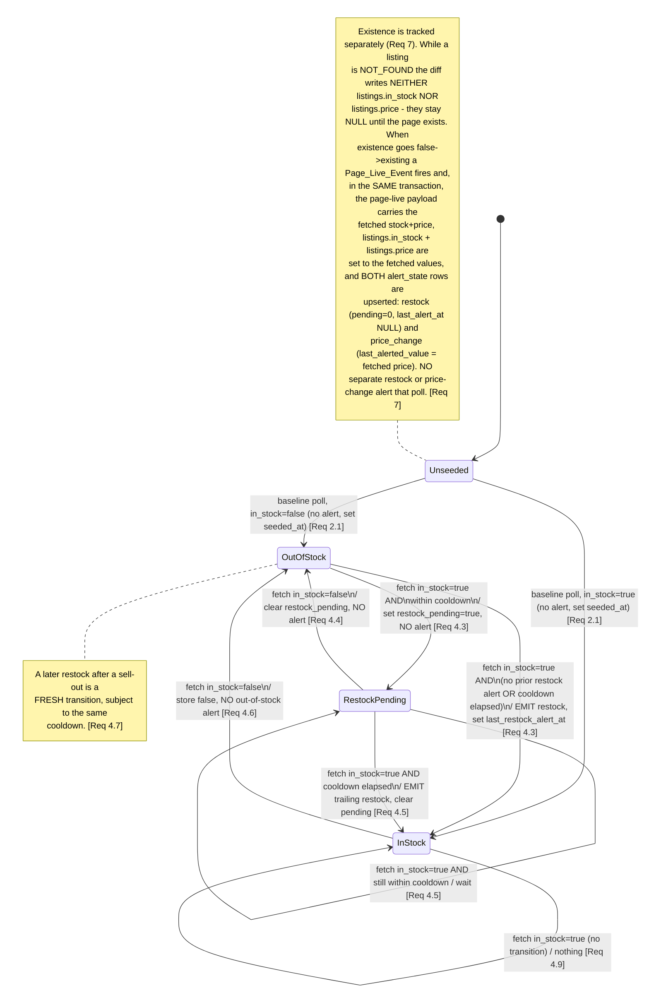

# Design Document

## Overview

The Stock & Drop Monitor is a single-process, async Python 3.12 backend that polls trading-card
retailers, detects alertable state transitions (new product, restock, price change, page-live), and
delivers Discord webhook alerts durably through an outbox. The MVP targets one Shopify retailer
(Northern Card Gaming) but the architecture is extensibility-first: new games, products, retailers,
listings, and discovery feeds are added through YAML + `.env` alone, and all retailer-specific logic
sits behind a uniform `Adapter` interface resolved from a registry (Req 11, 13, 22).

The design is organised around three pillars:

1. **A retailer-agnostic core.** `watcher`, `diffing`, `notifier`, `persistence`, and `config` know
   nothing about Shopify. They speak only in terms of `ProductState`, `DiscoveredProduct`, and the
   `Adapter` protocol. Adding an adapter type is a new module under `adapters/` plus a registry entry
   — never a change to the core (Req 11.1, 11.3, 11.9, 13.7).

2. **Durable, atomic persistence.** Every detected transition writes its state change, `alert_state`,
   `alerts_outbox`, `alert_history`, and per-destination `alert_deliveries` rows inside one
   `BEGIN IMMEDIATE` transaction (Req 6). The Notifier then drains deliveries asynchronously, so an
   alert is never lost across restarts (Req 6.5).

   **Delivery is at-least-once, not exactly-once.** A durable outbox guarantees an alert is never
   *lost*: once committed, a delivery row is retried until it succeeds, expires, or fails. It does
   **not** guarantee an alert is never *duplicated*. The window is a crash between a successful Discord
   POST and the follow-up transaction that records `status = 'delivered'`: on restart the row is still
   `pending` (or has a stale `sending` lease) and will be re-POSTed, so the recipient can see the same
   alert twice. We accept at-least-once because the alternative (a distributed two-phase commit between
   Discord and SQLite) is not available, and a rare duplicate drop-alert is tolerable where a lost one
   is not. The lease mechanism (see Concurrency Model and the delivery DDL) narrows but cannot close
   this window. Property 11 is therefore stated only for clean, non-crash dispatch rounds (Req 10.8).

3. **Disciplined, polite polling.** One APScheduler job per retailer, non-overlapping, host-serialised
   with 1s spacing and bounded timeouts, honouring robots.txt, backing off on errors and blocks
   (Req 1, 15, 16). Each retailer job ticks at a fixed fine granularity and, on each tick, selects the
   entities whose effective due time has arrived (see Concurrency Model → Scheduling).

### Design ↔ Requirements map
// 
| Design section | Primary requirements |
|---|---|
| Module layout | 11, 13, 19, 20, 23 |
| SQLite schema (DDL) | 14, 6, 9, 12, 17, 18 |
| Adapter interface + Shopify_Adapter | 7, 11, 12, 16 |
| Poll → detect → persist → dispatch sequence | 1, 6, 8, 10 |
| Restock state machine + page-live payload | 2, 4, 7, 9 |
| New-product diff + tracked-listing duplicate suppression | 3 |
| Config YAML schema + NCG example | 12, 13, 18, 22 |
| Concurrency model (scheduler tick + independent scheduler heartbeat beat, DB executor, dispatch semaphore, feed-before-listing order, --once/--dry-run modes, --once disables watchdog) | 1, 6, 10, 14.16/14.17, 16, 19, 20 |
| Deployment (compose, non-root user with fixed uid/gid 10001, SIGTERM stops watchdog first then cancels polls, WAL checkpoint, watchdog) | 19.4, 19.5, 19.6, 19.10–19.13, 14.16/14.17 |
| Handle-rename + not-found resolution (redirect + feed) | 7.1, 11.8 |
| Image URL normalisation | 8.11 |
| Config identity (config_key) + bot-collision | 13.6, 14.4/14.5/14.14 |
| Admin notices (per scope_key) + admin_scope_state hourly limit + probe scheduling + heartbeat + watchdog | 10.11, 17.6–17.8, 19.6, 19.7, 19.8, 19.10, 17 |
| Admin_Digest hourly trigger (per scope_key, dispatch round, admin_scope_state-backed) | 17.6–17.8 |
| Admin rate-limit storage (admin_scope_state, per-scope hourly limit, zero-admin-destination logging) | 17 |
| Watchdog daemon thread (independent scheduler beat, per-await dispatch beats, in-memory monotonic heartbeats, os._exit) | 19.6, 19.7, 19.8, 19.10 |
| Lint + type-check convention (ruff, mypy --strict) | 19.2 |
| Correctness properties | 3, 4, 5, 6, 7, 8, 9, 10, 14, 16, 17, 18 (+ 2, 11) |
| Error handling | 2, 6.3, 7, 10, 11.8, 16, 17 |
| Testing strategy | 21 |

### Decisions not dictated by requirements

The requirements fix the language (3.12), the key libraries (httpx, APScheduler, SQLite — Req 19.3),
WAL + busy_timeout (Req 14.16/14.17), and TEXT-Decimal/UTC-ISO storage (Req 14.15/14.18). Everything
flagged below is a design choice made to satisfy those constraints and is called out again in the
closing summary:

- **Module boundaries** (the exact package tree) — chosen to keep core adapter-free.
- **Single project name `restockradar`** used identically for the repo root, the Python package, and
  the docker-compose service — chosen for consistency (resolves the earlier repo/package mismatch).
- **`sqlite3` from the stdlib behind one dedicated single-thread executor that owns the connection** —
  chosen because the schema is small, prices must be exact TEXT Decimals, and a second process (the
  bot) shares the file, so explicit `BEGIN IMMEDIATE` control matters more than ORM convenience. All
  blocking `sqlite3` calls run on that executor and never on the event loop.
- **Fine-grained scheduler tick (default 5s, configurable)** per retailer job, with due-ordered
  entity selection — chosen so the effective poll rate matches the configured interval rather than
  drifting to ~2× it.
- **At-least-once delivery with a short `sending` lease** rather than attempting exactly-once —
  forced by the absence of a cross-system transaction between Discord and SQLite. The lease duration
  is **60s, configurable** (`RR_DELIVERY_LEASE_S`) — resolved here from the previously-open question.
- **A per-delivery total in-request time budget of 45s** covering that delivery's up-to-3 retries, so
  a destination that keeps answering with large `Retry-After` values cannot pin a worker open longer
  than the budget — a design choice balancing timeliness (Req 10.1's 60s target) against politeness.
- **One dispatch worker task per destination** so a slow destination cannot delay others, bounded by a
  **global dispatch concurrency semaphore (default 10, configurable** via `RR_DISPATCH_CONCURRENCY`**)**
  so a round that fans out to many destinations cannot open unbounded concurrent POSTs — resolved here
  from the previously-open worker-cap question.
- **A stable `config_key` on listings, discovery feeds, and destinations** so the loader can upsert
  and the bot-collision check (Req 13.6) can compare a single column.
- **In-memory monotonic heartbeats (`time.monotonic()`) as the watchdog's sole liveness source**,
  updated directly by the scheduler loop, the per-entity / per-HTTP-request / per-pagination hooks,
  and the dispatch loop — chosen so the watchdog never reads the database and so a wedged DB executor
  cannot mask (or be masked by) a wedged loop.
- **The `heartbeat` DB table retained solely for the external container healthcheck**, written from
  the loops at most every 5s — chosen so the healthcheck has a cross-process liveness signal without
  the watchdog depending on the database. It is no longer what the watchdog reads.
- **Versioned, forward-only, numbered SQL migration files** applied on startup with
  `isolation_level=None` and explicit `BEGIN IMMEDIATE`, splitting each file into statements with
  `sqlite3.complete_statement` and running them with `execute()` (never `executescript`, which forces
  an implicit COMMIT) so the whole file plus its version row commit as one transaction.
- **A dedicated watchdog daemon thread** (not an asyncio coroutine) that compares in-memory monotonic
  heartbeats against fixed, `RR_`-configurable thresholds (scheduler 120s, dispatch 60s) and, on
  staleness, logs and calls `os._exit(1)` — a hard exit that bypasses async teardown so the Docker
  restart policy restarts the container (Docker does not restart a merely-unhealthy container). A
  separate thread is chosen so a blocked event loop cannot also block the watchdog.
- **An independent scheduler-liveness beat, decoupled from any retailer job.** The scheduler heartbeat
  is beaten from a dedicated APScheduler interval job (the app's own liveness tick) that runs every
  `tick_s` regardless of whether any retailer job runs. This is a deliberate choice so a deployment with
  **zero enabled retailers** — or one whose only retailers are all deferred by backoff — cannot trip the
  watchdog: the beat does not depend on any entity being polled. Per-entity beats during a poll still
  refresh the same timestamp, but they are an *addition* to, not the source of, scheduler liveness.
- **The watchdog is disabled in `--once` mode.** A one-shot run is bounded by the once-mode drain
  timeout rather than by liveness thresholds, so the watchdog is simply not started for `--once`; this
  avoids a long legitimate drain being mistaken for a stall.
- **Admin rate-limit state lives in its own `admin_scope_state` table, not on incidents.** The
  per-`scope_key` hourly admin-warning limit is backed by `admin_scope_state.last_warning_at` so that
  the `destination:<id>` and `system` scopes — which have no incident — have a well-defined home for
  their `last_warning_at`. `incidents.last_warning_at` is retained only as incident-local bookkeeping;
  the authority for the hourly limit across all scopes is `admin_scope_state` (never pruned).
- **Tracked-listing duplicate suppression for new-product events.** A discovered product that matches an
  enabled `Listing` on the same retailer (same `external_id`, OR same `handle`) is recorded in
  `seen_products` but emits **no** new-product alert, because that product is already covered by its
  Listing (page-live, restock, price). This deliberately suppresses what would otherwise be a duplicate
  page-live-and-new-product pair for the same product.
- **ruff and `mypy --strict` are part of the definition of done.** Both must pass on the codebase; this
  is a project convention (see Project Notes / Testing Strategy), not a runtime behaviour.
- **A watchdog startup grace of 120s (`RR_WATCHDOG_STARTUP_GRACE_S`)** during which heartbeats are
  treated as fresh — chosen so stale state from a prior run can never trigger a crash loop at startup.
- **Admin notices scoped by a `scope_key` string** (`'retailer:<id>'` | `'destination:<id>'` |
  `'system'`) with the hourly rate limit and the Admin_Digest computed per `scope_key` — chosen so a
  warning that is not naturally tied to a retailer (a destination-level or system-level warning) still
  has a well-defined coalescing bucket.
- **A configurable `--once` drain timeout (`RR_ONCE_DRAIN_TIMEOUT_S`, default 120s)** bounding how long
  one on-demand cycle drains the outbox before it stops and reports the remaining count — chosen so
  `--once` cannot hang forever on an unreachable destination.
- **Index choices** on the hot paths (due polling, pending deliveries, seen-products lookups, open
  incidents, admin-notice digest-age per scope_key).
- **`AsyncIOScheduler`, `pydantic` for config validation, `tenacity`-style hand-rolled backoff,
  `unicodedata` for keyword normalisation, `Hypothesis` + `pytest` + `pytest-asyncio` for tests** —
  none of these specific choices beyond the three named libraries are mandated.

---

## Architecture

### Module Layout

Python 3.12, fully type-annotated. The project name `restockradar` is used identically for the repo
root, the Python package, and the docker-compose service. The guiding rule (Req 11, 13): the
**core never imports from `adapters/`** except through the `Adapter` protocol and the registry, so a
new retailer type is config + one adapter module and nothing else.

```text
restockradar/
├─ pyproject.toml                 # deps: httpx, apscheduler, pydantic, pyyaml, python-dotenv
│                                 # dev deps: hypothesis, pytest, pytest-asyncio, ruff, mypy (strict mode)
│                                 # DoD: `ruff` and `mypy --strict` must pass (Req 19.2)
├─ docker-compose.yml             # Req 19.4/19.5/19.6: service `restockradar`, restart: unless-stopped, healthcheck
├─ Dockerfile                     # creates non-root user with FIXED uid/gid 10001 (useradd -u 10001 -g 10001),
│                                 # USER 10001:10001; the shared bot must use the same uid/gid for WAL sidecars
├─ config/
│  └─ config.yaml                 # the YAML in the Config YAML Schema section (Source=config entities)
├─ migrations/
│  ├─ 0001_initial.sql            # forward-only, numbered (see Data Models)
│  └─ ...
├─ fixtures/                      # Req 21.3, 22.8: saved NCG JSON/HTML for tests
│  ├─ collections_pokemon_page1.json
│  ├─ products_<handle>.js.json
│  └─ soft_block.html
├─ src/restockradar/
│  ├─ __main__.py                 # entrypoint: arg parse (--dry-run, --once), wiring, run (Req 20)
│  ├─ app.py                      # Monitor: builds dependencies, owns lifecycle + SIGTERM shutdown
│  │                              #   (SIGTERM stops the watchdog FIRST, then cancels polls); hosts the
│  │                              #   independent scheduler-liveness beat (interval job every tick_s)
│  ├─ settings.py                 # process-level settings from env (db path, busy_timeout, retention, modes, tick_s)
│  │
│  ├─ config/                     # ── CONFIG LOADING (Req 13, 18) ──
│  │  ├─ schema.py                # pydantic models for the YAML (see Config YAML Schema)
│  │  └─ loader.py                # Config_Loader: validate-all-then-upsert by config_key, Source rules, re-baseline
│  │
│  ├─ persistence/                # ── REPOSITORY LAYER + MIGRATIONS (Req 14, 6) ──
│  │  ├─ db.py                    # Database: single-thread executor owning the sqlite3 connection; async methods;
│  │  │                           #   WAL/busy_timeout PRAGMAs; synchronous BEGIN IMMEDIATE ctx mgr; WAL checkpoint
│  │  ├─ migrate.py               # versioned, forward-only migration runner (see Data Models)
│  │  ├─ types.py                 # Decimal<->TEXT, bool<->INTEGER, datetime<->ISO-8601 UTC adapters
│  │  ├─ repository.py            # typed repo methods; the single-writer transaction helpers (sync, run on executor)
│  │  └─ pruning.py               # Req 14.20 retention sweep (outbox/deliveries/history only)
│  │
│  ├─ adapters/                   # ── ADAPTER INTERFACE + REGISTRY + SHOPIFY (Req 11, 12) ──
│  │  ├─ base.py                  # Adapter Protocol/ABC + ProductState/DiscoveredProduct/VariantState
│  │  ├─ registry.py              # Adapter_Registry: adapter-type str -> factory
│  │  ├─ errors.py                # FetchError, Blocked, SoftBlock, MalformedResponse, TruncatedFeed (NO NotFound)
│  │  ├─ keywords.py              # Unicode-normalised, accent/case-insensitive include/exclude match (Req 3.3/3.4)
│  │  └─ shopify.py               # Shopify_Adapter: .js fetch (404 => NOT_FOUND state; explicit 301/302/307/308
│  │                              #   same-host redirect resolution) + collection/products.json discovery
│  │
│  ├─ http/                       # ── POLITE HTTP (Req 1.4, 15, 16) ──
│  │  ├─ client.py                # HttpClient: httpx.AsyncClient wrapper; UA header, 30s timeout, response
│  │  │                           #   classification, AND robots.txt enforcement in the request path (Req 15.5)
│  │  ├─ host_gate.py             # per-host serialisation: one in-flight + 1s spacing
│  │  └─ robots.py                # robots.txt fetch+cache(24h), allow/deny, retry-later (used by HttpClient)
│  │
│  ├─ watcher/                    # ── WATCHER / SCHEDULER CORE (Req 1, 2, 12) ──
│  │  ├─ scheduler.py             # AsyncIOScheduler: one job/retailer ticking at fixed tick_s, coalesce,
│  │  │                           #   max_instances=1, stagger; PLUS one dedicated interval job (every
│  │  │                           #   tick_s) that beats the scheduler heartbeat independently of any
│  │  │                           #   retailer job, so zero enabled retailers cannot trip the watchdog
│  │  ├─ core.py                  # per-retailer tick: retailer backoff gate (reads backoff_state), select due
│  │  │                           #   entities ordered by due time, feeds BEFORE listings, fetch-then-transact
│  │  │                           #   sequentially, per-poll 5min cap, scheduler heartbeat refreshed between
│  │  │                           #   entities (ADDITIONAL to the independent scheduler-beat interval job)
│  │  ├─ due.py                   # effective-due-time = max(next_due_at, backoff_until) (Req 1.8)
│  │  └─ backoff.py               # Backoff_State: ordinary vs Blocked exponential backoff (Req 16)
│  │
│  ├─ detect/                     # ── DIFFING / EVENT DETECTION (Req 3,4,5,7,9) ──
│  │  ├─ events.py                # NewProductEvent, RestockEvent, PriceChangeEvent, PageLiveEvent, AdminWarning
│  │  ├─ diff_listing.py          # restock/price/page-live transition logic + cooldown/pending (Req 4,5,7,9)
│  │  ├─ diff_feed.py             # new-product detection vs seen_products, keyword filtering (Req 3,12);
│  │  │                           #   SUPPRESSES the new-product alert (but still records seen_products)
│  │  │                           #   when the product matches an enabled Listing on the same retailer
│  │  │                           #   by external_id OR handle (the Listing already covers it)
│  │  └─ fanout.py                # resolve matching enabled+healthy destinations -> delivery rows (Req 6.2, 8.1)
│  │
│  ├─ notifier/                   # ── NOTIFIER / OUTBOX DISPATCH + DISCORD (Req 8, 10, 17) ──
│  │  ├─ dispatch.py              # single-flight loop (<=5s): one worker task per destination bounded by a
│  │  │                           #   global concurrency semaphore (default 10); lease (60s), POST, retry,
│  │  │                           #   expire, mark terminal; set outbox.terminal when all deliveries terminal;
│  │  │                           #   each round triggers the per-scope_key hourly Admin_Digest when a scope's
│  │  │                           #   admin_scope_state window has elapsed; NEVER routes a warning about a
│  │  │                           #   destination through that same destination
│  │  ├─ discord.py               # embed formatting, allowed_mentions, markdown escape, batching, 400-split (Req 8)
│  │  ├─ webhook.py               # POST with in-request retry + Retry-After under a 45s total budget; beats the
│  │  │                           #   dispatch heartbeat at EVERY await boundary (before POST, after response,
│  │  │                           #   before/after each retry sleep); GET probe (Req 10.3/10.11)
│  │  └─ health.py                # destination health transitions, incidents, admin digest, probe scheduling (Req 10, 17)
│  │
│  ├─ incidents/                  # ── HEALTH / INCIDENTS (Req 17) ──
│  │  └─ incidents.py             # open/close incidents; per-scope_key hourly rate-limit backed by
│  │                              #   admin_scope_state.last_warning_at (covers destination:/system scopes
│  │                              #   that have no incident); admin_notices parking; Admin_Digest
│  │
│  ├─ observability/              # ── LOGGING / REDACTION / HEALTH (Req 18, 19) ──
│  │  ├─ logging.py               # stdout logging, httpx/httpcore->WARNING, redaction filter (Req 18.3/18.4)
│  │  ├─ healthcheck.py           # container healthcheck probe: reads the heartbeat TABLE (scheduler+dispatch
│  │  │                           #   rows, written <=5s) + DB writability; fixed thresholds (sched 120s,
│  │  │                           #   dispatch 60s). NOT what the watchdog reads (Req 19.6)
│  │  └─ watchdog.py              # dedicated DAEMON THREAD: compares in-memory monotonic heartbeats
│  │                              #   (time.monotonic(); scheduler beat from an INDEPENDENT interval job
│  │                              #   plus per-entity/per-HTTP hooks, dispatch beat at every POST await
│  │                              #   boundary) against fixed RR_ thresholds (sched 120s, dispatch 60s)
│  │                              #   after a 120s startup grace; on staleness logs + os._exit(1) so the
│  │                              #   restart policy restarts (Req 19.6/19.10). NOT started in --once mode
│  │
│  └─ domain/                     # ── SHARED TYPES ──
│     ├─ models.py                # Game, Product, Retailer, Listing, DiscoveryFeed, Destination (frozen dataclasses)
│     └─ ids.py                   # subject_key / scope_key builders; event-type enum
└─ tests/
   ├─ conftest.py                 # no-network transport guard (Req 21.4), temp db, frozen clock
   ├─ test_diffing.py             # Req 21.1,5,6,7,24,25,26,28
   ├─ test_shopify_adapter.py     # Req 21.2,3,10,14,20,21
   ├─ test_persistence_atomicity.py # Req 21.11
   ├─ test_notifier_delivery.py   # Req 21.12,15,16,17
   ├─ test_cooldown.py            # Req 21.9,18
   ├─ test_pagelive.py            # Req 21.19,27
   ├─ test_config_loader.py       # Req 21.13,22,23
   └─ test_modes.py               # Req 21.29,30
```

**Responsibility summary of each module group:**

- **`config/`** — reads YAML, validates with pydantic (fail-fast, all-errors-in-one-pass, Req 13.6),
  upserts by stable id / `config_key`, enforces the `config` vs `bot` Source ownership rule (comparing
  `config_key` for the bot-collision check), and clears `seeded_at` on re-enable (Req 13.2–13.6).
  Secrets never live here; destinations store only the env-var name.
- **`persistence/`** — owns the schema, the migration runner, the type adapters (Decimal/bool/UTC),
  and the single `BEGIN IMMEDIATE` transaction helper every mutating path funnels through (Req 6, 14).
  All `sqlite3` work runs on **one dedicated single-thread executor that owns the connection**; the
  module exposes `async` methods, so blocking SQLite is never called on the event loop.
- **`adapters/`** — the only place retailer-specific code lives. `base.py` defines the contract; the
  core depends only on `base.py` and `registry.py`. A 404 on a product endpoint is **returned** as a
  `ProductState` with `existence = NOT_FOUND`, never raised (Req 7.1).
- **`http/`** — enforces per-host politeness independent of adapter type, and enforces robots.txt
  **inside the client request path** so no adapter can bypass it (Req 1.4, 15).
- **`watcher/`** — scheduling and the poll loop; decides *what* to poll and *when* (fixed-tick,
  due-ordered selection), then calls the adapter and hands results to `detect/`. Within a
  retailer-job run it processes **discovery feeds before listings**, so `cycle_products` is populated
  before any listing fetch needs it (for feed-reuse and handle-rename resolution). The stored state
  and destinations it diffs against are read *inside* the write transaction, after the fetch (see
  Concurrency Model). The watcher — not the adapter — writes a resolved handle/url change and queues
  the handle-change admin notice, inside its own transaction, when the adapter reports a rename via
  `ProductState.resolved_handle` / `resolved_url`.
- **`detect/`** — pure-ish diffing. Given stored state + fetched state + clock, it decides which
  events fire and builds the write-set. This is the main property-tested surface (see Correctness
  Properties).
- **`notifier/` + `incidents/`** — the async side: durable at-least-once delivery with a 60s `sending`
  lease and a 45s per-delivery in-request budget, one worker task per destination bounded by a global
  dispatch concurrency semaphore (default 10), retries, destination health and probe scheduling, admin
  warnings/digests backed by `admin_notices` with the per-`scope_key` hourly limit backed by
  `admin_scope_state`, and the hourly `Admin_Digest` trigger evaluated once per dispatch round. The
  dispatch worker beats the dispatch heartbeat at **every await boundary of a POST attempt** (before the
  POST, after the response, and before and after each retry sleep) so a long retry sequence inside the
  45s budget can never leave the 60s dispatch threshold un-beaten. A warning **about** a destination is
  never routed **through** that same destination; a warning about destination X fans out only to the
  *other* enabled, healthy admin destinations, and if none exist it is logged (redacted) rather than
  sent.
- **`observability/`** — logging to stdout with redaction, the container healthcheck (which reads the
  `heartbeat` **table** rows plus DB writability), and the **watchdog daemon thread** that compares
  **in-memory monotonic heartbeats** against fixed thresholds and calls `os._exit(1)` when a beat goes
  stale (so the Docker restart policy restarts the container, since Docker does not restart a
  merely-unhealthy container on its own). The watchdog never reads the database. The scheduler beat it
  reads is refreshed by an **independent interval job** (every `tick_s`) that does not depend on any
  retailer job, so zero enabled retailers cannot trip it; the watchdog is **not started at all in
  `--once` mode** (that run is bounded by the once-mode drain timeout instead).
- **Operational modes** are threaded through `__main__.py` → `app.py`: `--dry-run` flips the webhook
  sender to a redacted log sink, **skips destination health probes**, and **drains immediately** with
  no real POSTs (Req 20.1–20.3); `--once` reclaims stale `sending` leases, **runs with the watchdog
  disabled** (bounded by the drain timeout, not by liveness thresholds), runs one cycle treating all
  pending deliveries as due **ignoring `next_attempt_at`, `next_due_at`, and backoff for enabled
  entities** (still obeying robots and host spacing), drains the outbox under a configurable drain
  timeout, and exits 0 only if no pending/sending deliveries remain (Req 20.4/20.5).

### Concurrency Model

**One process, async, single SQLite writer.** The entire monitor runs in one asyncio event loop. All
SQLite work is delegated to one dedicated single-thread executor (see "DB access" below).

**Scheduling (Req 1).** `AsyncIOScheduler` runs exactly one job per retailer (Req 1.5). Rather than
triggering a job once per `poll_interval_s`, each retailer job ticks at a **fixed fine granularity**
(`tick_s`, default 5s, configurable). This is a design refinement of the Req 1.5 wording "that job
SHALL tick at the Retailer's Poll_Interval": a coarse tick exactly equal to a poll interval, combined
with positive jitter on `next_due_at`, caused each entity to just-miss its own tick and only fire on
the *following* one, roughly doubling the effective interval. A fine tick removes that coupling — the
tick is just a clock, and *due selection* decides what actually runs.

On each tick the job:

1. Reads the retailer's `backoff_state` row (`scope_key = 'retailer:<id>'`) and treats its
   `backoff_until` as the retailer's effective due time — the single home for retailer-level backoff
   (the `retailers` table carries neither a `next_due_at` nor a `backoff_until` column). The
   retailer-level check exists *only* for retailer-wide backoff: a Blocked retailer defers **all** of
   its feeds and listings (Req 1.5, 16.5). If `backoff_until` is in the future, the whole job defers
   and processes nothing this tick.
2. Otherwise it `SELECT`s the retailer's enabled feeds and listings whose effective due time
   `max(next_due_at, backoff_until) <= now`, **ordered by effective due time ascending**, and processes
   them **sequentially** (Req 1.6), always taking **discovery feeds before listings** at equal due
   time so that this run's `cycle_products` map is populated before any listing fetch consults it for
   feed-reuse (Req 11.6) or handle-rename resolution (Req 11.8). Due-ascending ordering is what keeps
   polling fair when the 5-minute per-poll cap (Req 1.3) means not every due entity can be serviced in
   one tick: the entity that has been waiting longest goes first.
3. For each processed entity, when its poll finishes it sets that entity's `next_due_at` to
   finish-time + the entity's own `poll_interval_s` + jitter (Req 1.7), and refreshes the `scheduler`
   heartbeat (so a long poll loop still beats *between* entities, not only at tick start — Req 19.7).
   This per-entity refresh is an **addition** to, not the source of, scheduler liveness.

**The scheduler heartbeat is an independent liveness beat.** Scheduler liveness does **not** depend on
any retailer job running. A dedicated APScheduler interval job (the app's own liveness tick, hosted in
`app.py` / `scheduler.py`) beats the in-memory `scheduler` heartbeat **every `tick_s`** regardless of
whether any retailer is enabled, due, or deferred by backoff. This is deliberate: a deployment with
**zero enabled retailers**, or one whose only retailers are all in retailer-wide backoff, would
otherwise never run a poll and the scheduler beat would go stale, tripping the watchdog into
`os._exit`. With the independent beat, liveness tracks that the event loop and scheduler are alive, not
whether a poll happened to run. The per-entity beats described above still refresh the same timestamp
during a long poll, but they are supplementary — the independent interval job is the guaranteed
floor. (In `--once` mode the watchdog is disabled entirely, so this beat is irrelevant there.)

A retailer's `poll_interval_s` is the **default interval inherited** by its feeds and listings that do
not set their own; it is no longer itself a tick cadence. Jobs are configured `coalesce=True` and
`max_instances=1`, so a tick still running at the next tick time does not overlap — the missed tick is
coalesced (Req 1.9). Initial ticks are staggered across retailers at startup (Req 1.10).

**Per-host politeness (Req 1.4, 15).** `http/host_gate.py` holds one `asyncio.Lock` per retailer host
and a last-request timestamp, guaranteeing at most one in-flight request per host and ≥1s spacing
between successive requests to the same host. robots.txt is enforced inside `http/client.py` on the
request path, so an adapter cannot issue a disallowed request even by mistake (Req 15.5). Each request
carries a 30s timeout (Req 1.2); the whole per-retailer tick's processing is wrapped in a 5-minute cap
via `asyncio.timeout(300)` (Req 1.3). Discord delivery is explicitly exempt from host spacing (Req 1.4)
and governed only by Req 10.

**DB access — one executor owns the connection.** All blocking `sqlite3` calls run on a single
dedicated executor thread that owns the one write connection; `persistence/db.py` exposes `async`
wrappers that submit work to that executor and `await` the result, so **the event loop never makes a
blocking SQLite call**. Because exactly one thread touches the connection, there is never intra-process
contention on it. The transaction helper is **synchronous** — it runs entirely on the executor thread
with **no `await` inside the lock** — so a transaction can never yield the event loop mid-write and can
never interleave with another coroutine's read-modify-write.

**SQLite write serialisation — single-writer discipline.** Every mutating transaction uses
`BEGIN IMMEDIATE`, which acquires the write lock up front. The database is opened in WAL mode with a
configured `busy_timeout` (Req 14.16/14.17) so that (a) readers never block the writer and (b) the
later shared bot process can take the write lock without immediate `SQLITE_BUSY` failures. Because WAL
permits only one writer at a time across processes, the `busy_timeout` is what makes cross-process
sharing safe.

**Why no network I/O inside a transaction, and what is read inside it.** The poll is strictly ordered
*fetch → BEGIN IMMEDIATE → read → diff → write → COMMIT*:

1. The adapter completes **all HTTP work** and returns a `ProductState` / product list **before** any
   transaction opens. **No DB lock is held during the fetch.**
2. Only then does `BEGIN IMMEDIATE` open. **Inside** the transaction the watcher reads the *current*
   stored state for the subject, its `alert_state` row(s), **and** the set of enabled + healthy
   destinations for the alert's game. These reads happen inside the transaction (after the fetch),
   never before it, so the state the diff sees cannot be changed by a concurrent writer between the
   read and the write.
3. `detect/` computes the full write-set in memory (a pure function of stored state + fetched state +
   destinations + clock).
4. The transaction writes stored state, `alert_state`, `alerts_outbox`, `alert_history`, and one
   `alert_deliveries` row per matching destination, then `COMMIT`s.

Transactions therefore hold the write lock for microseconds, never for the duration of a 30s HTTP call,
yet still see a consistent snapshot of stored state and destinations — satisfying the atomic write-set
of Req 6 without starving the bot process or the notifier.

**The Notifier dispatch loop is a separate, single-flight task.** It is an independent coroutine that
wakes at most every 5s (Req 10.2). The loop itself is **single-flight**: a new round never starts while
the previous one is still running, so dispatch rounds never overlap. Within a round there is **one
worker task per destination**, run concurrently but bounded by a **global dispatch concurrency
semaphore** (`RR_DISPATCH_CONCURRENCY`, default 10) so the total number of destination workers POSTing
at once is capped regardless of how many destinations are due; the cap is global across the round, not
per retailer. The semaphore keeps a slow or rate-limited destination from delaying deliveries to any
other destination past the 60s target while still bounding outbound concurrency (Req 1.4-exempt,
Req 10.1/10.7). **The lease covers only the batch about to be POSTed, not the worker's whole queue.**
Immediately **before each batch POST**, the worker opens a short transaction that marks exactly the
`alert_deliveries` rows in that one batch `status = 'sending'` and sets their `lease_until = now + lease`
where the **lease is 60s, configurable** (`RR_DELIVERY_LEASE_S`); it then POSTs that batch (never
holding a transaction open across the network call), and finally opens a short transaction to record
the batch's outcome. A worker that holds several batches for one destination acquires the `sending`
lease per batch, right before that batch's POST — it never claims all of its pending rows up front.

**Per-delivery in-request budget (45s) vs Retry-After.** A single delivery's whole in-request effort —
its initial POST plus up to 3 retries with exponential backoff honouring `Retry-After` — must complete
within a **total time budget of 45s** (`RR_DELIVERY_BUDGET_S`). Before sleeping for a retry (whether a
`Retry-After` value or computed backoff), the worker checks the remaining budget: **if the required
wait would exceed the remaining in-request budget, the worker stops retrying immediately, sets the
delivery back to `status = 'pending'` with `next_attempt_at = now + Retry-After` (or the computed
backoff when no `Retry-After` is present), records the attempt and `last_error`, releases the semaphore
and frees the worker.** The delivery is simply picked up again by a later dispatch round at
`next_attempt_at` — this bounds how long one destination can pin a worker without discarding the
delivery (which remains subject to the 1-hour max-age expiry of Req 10.7).

**Dispatch heartbeat at every POST await boundary.** Because a single delivery's in-request effort can
span up to 45s (the initial POST plus up to 3 retries, each possibly preceded by a `Retry-After` or
backoff sleep), the dispatch worker beats the in-memory `dispatch` heartbeat at **every await boundary
of a POST attempt**: immediately **before** the POST, immediately **after** the response arrives, and
**before and after each retry sleep**. This guarantees that no single await inside the 45s per-delivery
budget can leave the 60s dispatch threshold un-beaten — a long legitimate retry sequence (large
`Retry-After` values within budget) therefore cannot trip the watchdog, while a genuinely wedged POST
(one await that never returns) still goes stale and triggers the self-heal. The beat is in addition to
the per-round beat at the top of each dispatch round.

A `sending` row whose `lease_until` has passed (e.g. a crash mid-POST) is reclaimed to `pending` and
the reclamation counts as an attempt. Because delivery is at-least-once, the lease narrows — but does
not eliminate — the duplicate window described in the Overview. Each dispatch round also evaluates the
**hourly Admin_Digest trigger**: for each `scope_key` it checks whether un-digested `admin_notices`
rows exist for that scope **and** `(now − admin_scope_state.last_warning_at) ≥ 1 hour` and, if so,
emits exactly one `Admin_Digest` alert folding every un-digested notice for that `scope_key`, fans it
out to the enabled, healthy admin destinations (**excluding the destination the warning is about** when
the `scope_key` is `destination:<id>`), stamps `digested_at`, **and updates that scope's
`admin_scope_state.last_warning_at` to now**. If that leaves zero eligible admin destinations the digest
is logged (redacted) and its notices stay un-digested with `last_warning_at` unchanged. Admin notices are coalesced per `scope_key`
(`'retailer:<id>'` | `'destination:<id>'` | `'system'`), so a retailer-level, a destination-level, and
a system-level warning each get their own hourly window (backed by its own `admin_scope_state` row) and
its own digest. The per-scope hourly limit is backed by `admin_scope_state`, not by
`incidents.last_warning_at`, precisely because the `destination:<id>` and `system` scopes have no
incident to carry that timestamp.

**Operational modes: `--once` and `--dry-run`.** In normal mode the scheduler and dispatch loop run
continuously. In **`--once`** mode the Monitor runs exactly one on-demand cycle and then drains, with
these precise semantics (Req 20.4/20.5):

0. **Watchdog disabled.** In `--once` mode the watchdog daemon thread is **not started**. A one-shot
   run is bounded by the once-mode drain timeout (step 4), not by liveness thresholds, so there is no
   watchdog to mistake a long-but-legitimate drain for a stall and no in-memory heartbeat requirement.
1. **Reclaim first.** At start, every stale `sending` lease (`lease_until < now`) is reclaimed to
   `pending` so a crash from a prior run cannot strand deliveries.
2. **All pending are due.** Every `pending` delivery is treated as due immediately, **ignoring
   `next_attempt_at`**; the one cycle likewise ignores `next_due_at` and `backoff_until` for enabled
   entities (robots.txt and host spacing are still obeyed).
3. **Retry-After only within the budget.** A `Retry-After` or computed backoff is honoured **only
   within the per-delivery in-request budget (45s)**; a wait exceeding the remaining budget does not
   sleep the drain — the delivery is returned to `pending` with `next_attempt_at` set, to be counted
   against the exit condition below.
4. **Bounded drain.** Draining stops after a configurable **drain timeout** (`RR_ONCE_DRAIN_TIMEOUT_S`,
   default 120s) even if deliveries remain, so an unreachable destination cannot hang the run.
5. **Exit code reflects completion.** The process exits **0 only if no `pending` or `sending`
   deliveries remain**; otherwise it exits **non-zero** and logs the remaining count.

In **`--dry-run`** mode drain is **immediate**: every webhook POST is replaced by a redacted log line
with no real network call, so the drain completes without waiting on Discord (destination health probes
are also skipped). `--once` and `--dry-run` compose — a `--once --dry-run` run renders all pending
deliveries to the log, marks them `delivered`, and exits 0.

**Liveness: in-memory monotonic heartbeats and the watchdog daemon thread.** Liveness is tracked by
**two in-memory monotonic timestamps** (`time.monotonic()`), *not* by the database: a `scheduler`
heartbeat and a `dispatch` heartbeat. They are updated directly, in process, by:

- an **independent scheduler-beat interval job** that runs every `tick_s` and beats the `scheduler`
  heartbeat **unconditionally**, whether or not any retailer job runs — this is the guaranteed floor
  that keeps a zero-retailer (or all-backed-off) deployment from tripping the watchdog;
- additionally the **per-entity hook** between entities within a tick (so a long poll loop keeps
  beating), and the **per-HTTP-request / per-pagination hooks** inside the adapter (so a slow
  multi-page discovery crawl or a long individual request still beats *during* the request) — these
  supplement, but are not relied on as the source of, the scheduler beat;
- the **dispatch loop** on every round **and at every await boundary of a POST attempt** — before the
  POST, after the response, and before and after each retry sleep — so a long retry sequence inside the
  45s per-delivery budget keeps the dispatch beat fresh while the round is still in progress and can
  never let the 60s dispatch threshold lapse without a beat.

In `--once` mode the watchdog daemon thread is **not started** at all; the run is bounded by the
once-mode drain timeout, so these heartbeats are not consulted for liveness in that mode.

Both heartbeats are **initialised at process startup** and the watchdog applies a **startup grace of
120s** (`RR_WATCHDOG_STARTUP_GRACE_S`) during which staleness is never flagged, so stale state from a
prior run cannot cause a crash loop. The **watchdog is a dedicated daemon thread** (not an asyncio
coroutine): it wakes on a short interval, compares `now_monotonic − scheduler_beat` against the
**fixed scheduler threshold of 120s** (`RR_WATCHDOG_SCHEDULER_S`) and `now_monotonic − dispatch_beat`
against the **fixed dispatch threshold of 60s** (`RR_WATCHDOG_DISPATCH_S`), and, if either is stale
past the startup grace, **logs the stall and calls `os._exit(1)`**. `os._exit(1)` is a hard exit that
**bypasses async teardown** on purpose: a wedged event loop cannot run `finally`/cancel handlers, so a
graceful shutdown would itself hang — the hard exit lets the `restart: unless-stopped` policy restart
the container. Because the watchdog runs on its own thread and reads only the two in-memory timestamps
and the monotonic clock, it cannot itself be blocked by the component it is meant to catch, and it
never touches the database.

Separately, so that the **external container healthcheck** has a cross-process liveness signal, the
scheduler and dispatch loops also write the `heartbeat` **table** rows (`scheduler`, `dispatch`) **at
most every 5s** (a throttled write sitting alongside — and derived from the same points as — the
in-memory heartbeat updates, but never on the hot path of every entity/request). The healthcheck reads
those rows (plus a DB-writability probe); it is **not** what the watchdog reads. The table write is
best-effort liveness reporting for Docker; the authoritative self-heal path is the in-memory watchdog.

### Sequence Diagram — Poll → Detect → Persist → Dispatch

The atomicity boundary (Req 6) is the single `BEGIN IMMEDIATE` block: it reads the current stored
state, `alert_state`, and the enabled+healthy destinations, then writes stored state, `alert_state`,
`alerts_outbox`, `alert_history`, and all `alert_deliveries` rows together, then commits. **No network
I/O happens inside the transaction** — the adapter fetch completes first (holding no DB lock), the
reads happen *inside* `BEGIN IMMEDIATE` *after* the fetch, and the Notifier dispatch loop runs as a
wholly separate async task.

```mermaid
sequenceDiagram
    autonumber
    participant HB as Scheduler-beat job (independent, every tick_s)
    participant SCH as Scheduler (per-retailer job, ticks every tick_s)
    participant WC as Watcher_Core
    participant AD as Shopify_Adapter
    participant NET as Retailer host
    participant DET as detect/diffing
    participant DB as SQLite (via DB executor)
    participant DISP as Notifier dispatch loop (single-flight)
    participant DISC as Discord webhook

    loop every tick_s, independent of any retailer job (Req 19.7)
        HB->>HB: beat in-memory 'scheduler' (monotonic) — fires even with ZERO enabled retailers
    end

    SCH->>WC: tick(retailer)
    WC->>DB: SELECT backoff_state WHERE scope_key = retailer id
    WC->>WC: retailer_due = backoff_state.backoff_until (retailer-wide backoff only)
    alt retailer in backoff (retailer-wide defer, Req 1.5/16.5)
        WC-->>SCH: defer whole job this tick
    else retailer ok
        WC->>DB: SELECT due feeds+listings WHERE eff_due<=now ORDER BY eff_due ASC, feeds BEFORE listings (Req 1.6, 11.6)
        loop each due entity, sequential, within 5min cap (Req 1.3)
            Note over WC: feeds processed first -> cycle_products populated before any listing fetch
            WC->>AD: fetch_state(listing) / discover(feed)   %% NO DB lock held
            AD->>NET: GET .js / products.json (30s timeout, 1s host spacing)
            NET-->>AD: JSON (or 404 / HTML / 5xx)
            AD-->>WC: ProductState (existence=EXISTING|NOT_FOUND) / list[DiscoveredProduct] (or raises Blocked/FetchError)
            Note over WC,DB: fetch is DONE before BEGIN IMMEDIATE opens
            WC->>DB: BEGIN IMMEDIATE
            WC->>DB: SELECT current stored state + alert_state (inside txn, after fetch)
            WC->>DB: SELECT enabled+healthy destinations for this game (inside txn)
            WC->>DET: diff(stored_state, fetched, destinations, enabled_listings, clock)
            DET-->>WC: write-set {state deltas, events, delivery targets}
            Note over DET: new-product covered by an enabled Listing (same external_id OR handle) -> record seen_products, emit NO new-product alert (Req 3)
            alt fetched.existence=NOT_FOUND
                Note over WC,DB: do NOT write in_stock/price (stay NULL until page exists, Req 7); only existence/consecutive_404
            else fetched.existence=EXISTING
                opt stored existence was false => Page_Live_Event (Req 7)
                    Note over WC,DB: page-live payload carries CURRENT stock+price; set in_stock & last_alerted_price now; NO separate restock/price alert this poll
                end
                opt adapter reported a rename (resolved_handle/resolved_url set, Req 11.8)
                    WC->>DB: UPDATE listings SET url/handle; INSERT admin_notices(scope_key='retailer:<id>', handle_change)  %% in watcher txn
                end
            end
            WC->>DB: UPDATE listings/seen_products (stored state)
            WC->>DB: UPSERT alert_state ON CONFLICT(subject_key,event_type) (cooldown authority; restock/price_change only)
            WC->>DB: INSERT alerts_outbox (one per emitted alert)
            WC->>DB: INSERT alert_history (append-only)
            WC->>DB: INSERT alert_deliveries status=pending (one per enabled+healthy dest)
            WC->>DB: COMMIT  %% atomicity boundary (Req 6.1-6.3)
            Note over DB: if COMMIT fails, nothing persisted -> re-detected next poll (Req 6.3)
            WC->>WC: refresh in-memory 'scheduler' (monotonic) per entity + per HTTP req/page (ADDITIONAL to the independent beat, Req 19.7)
            WC->>DB: set entity.next_due_at = finish + interval + jitter (Req 1.7); UPDATE heartbeat TABLE 'scheduler' <=5s (healthcheck only, Req 19.9)
        end
    end

    loop every <=5s, separate single-flight task (Req 10.2)
        DISP->>DB: reclaim 'sending' rows whose lease_until<now -> 'pending' (counts as attempt)
        DISP->>DB: SELECT pending deliveries JOIN outbox WHERE next_attempt_at<=now
        DISP->>DISP: one worker task per destination, bounded by global semaphore (default 10) (Req 10.7)
        par per destination (concurrent, <= semaphore)
            loop each batch for this destination (<=10 embeds / 6000 chars)
                DISP->>DISP: drop batch's alerts older than max age -> mark expired (Req 10.7)
                DISP->>DB: short txn: status='sending', lease_until=now+60s ON JUST THIS BATCH's rows (before POST, Req 10.4)
                DISP->>DISP: beat in-memory 'dispatch' BEFORE POST, AFTER response, and before/after each retry sleep (Req 19.8)
                DISP->>DISC: POST this batch within 45s total budget (allowed_mentions, retry+Retry-After, 3x)
                alt 2xx
                    DISP->>DB: UPDATE this batch's deliveries status=delivered, delivered_at (Req 10.8)
                else Retry-After wait would exceed remaining 45s budget
                    DISP->>DB: this batch's rows -> status='pending', next_attempt_at=now+Retry-After, attempts+1, last_error; free worker
                else HTTP 400
                    DISP->>DISP: split batch into single-alert messages; retry each
                    DISP->>DB: single alert still 400 -> status=failed, last_error; admin notice; dest STAYS healthy
                else transient fail
                    DISP->>DB: this batch's rows -> UPDATE attempts, last_error, next_attempt_at (capped backoff); back to 'pending' (Req 10.4)
                else 401/403/404 permanent
                    DISP->>DB: mark dest X unhealthy + park admin notice(scope_key='destination:<id>'); its warning routes ONLY to OTHER healthy admin dests, else log-only (never through X) (Req 10.9)
                end
            end
        end
        DISP->>DISP: beat in-memory 'dispatch' (monotonic) per round (plus the per-await beats above) (watchdog reads this, Req 19.8/19.9)
        DISP->>DB: UPDATE heartbeat TABLE 'dispatch' <=5s (healthcheck only, Req 19.9)
        DISP->>DB: when ALL of an alert's deliveries are terminal -> set alerts_outbox.terminal=1
        DISP->>DB: per scope_key: if un-digested admin_notices exist AND (now - admin_scope_state.last_warning_at)>=1h -> emit one Admin_Digest to the OTHER admin dests, stamp digested_at + update last_warning_at (Req 17.6-17.8)
    end
```

Key separations shown: the watcher transaction is short and runs entirely on the DB executor (no
`await` inside it); the dispatch loop is an independent, single-flight coroutine with one worker per
destination (bounded by the global dispatch semaphore) that never participates in the watcher
transaction, so a slow Discord POST can never hold a write lock (Req 1, 6, 10). A `NOT_FOUND` fetch
never writes `in_stock`/`price` — those stay NULL until the page exists — and a `Page_Live_Event`
carries the current stock and price and suppresses any separate restock/price-change alert for that
same poll (Req 7). The dispatch loop sets `alerts_outbox.terminal = 1` once every delivery for an alert
has reached a terminal status (`delivered`, `expired`, or `failed`), making the row prunable
(Req 14.20), and evaluates the hourly `Admin_Digest` trigger **per `scope_key`** each round — firing
when un-digested notices exist for the scope **and** that scope's `admin_scope_state.last_warning_at`
is at least an hour old — fanning each digest out to the enabled, healthy admin destinations and
updating `admin_scope_state.last_warning_at` (Req 17.6–17.8). A digest or warning **about** a specific
destination never routes **through** that destination. The `sending` lease is
taken **per batch, immediately before that batch's POST** — never as an up-front claim of the
destination's whole queue — so a reclaimed lease only ever re-POSTs the one batch it covered.

### Deployment (Docker Compose, graceful shutdown)

The service ships as a single container run under Docker Compose (Req 19.4/19.5). Five points matter
for a WAL SQLite workload shared with a later bot process:

- **A non-root runtime user with a FIXED uid/gid.** The `Dockerfile` creates an unprivileged user with
  a **fixed numeric UID and GID of 10001** (e.g. `groupadd -g 10001 restockradar && useradd -r -u 10001
  -g 10001 restockradar`), `chown`s the app directory and the `/data` volume mountpoint to `10001:10001`,
  and ends with `USER 10001:10001` so the container runs as that user rather than root — the process only
  needs to read `config.yaml` and read/write the SQLite directory, so it drops root for defence in depth.
  The UID/GID is pinned to `10001` **on purpose**: the later bot service shares the same named volume and
  **must run with the identical UID/GID (10001)**, because WAL creates `-wal` and `-shm` sidecar files
  that both processes need to read **and write**. If the two services ran as different users, one would be
  unable to open the other's sidecar files and WAL sharing would break (see Project Notes).
- **A named volume for the SQLite directory.** WAL requires a real local filesystem (WAL/SHM
  memory-mapping does not work reliably over network/overlay mounts), so the database directory is a
  **named volume**, not a bind mount to a networked path. Both this monitor and the later bot mount
  the same named volume to share the file, and both must run as UID/GID `10001` so the shared `-wal`
  and `-shm` files are writable by each.
- **`config.yaml` mounted read-only.** The config is a bind mount with `:ro`; the loader only ever
  reads it.
- **Secrets via `env_file`.** The webhook URLs live in `.env`, loaded through `env_file:` — never baked
  into the image and never named in `config.yaml` (Req 18.1/18.2).
- **`stop_grace_period` + graceful SIGTERM shutdown.** On `SIGTERM`, `app.py`: (1) **stops the watchdog
  daemon thread FIRST** — before anything else — so the self-imposed quiet period of graceful shutdown
  (no new polls, no new dispatch rounds, heartbeats no longer refreshed) cannot itself look like a stall
  and trip the watchdog into `os._exit(1)` mid-shutdown; (2) stops the scheduler (including the
  independent scheduler-beat job) so no new entity poll or dispatch round begins; (3) **cancels any
  in-flight poll immediately** — because a poll persists its fetch results only in a final short
  transaction, cancelling an in-flight fetch/diff loses nothing (the entity is simply re-polled next
  start, and its stored state is unchanged); (4) lets any **open DB transaction** and any **in-flight
  webhook POST** finish within a 30s window; (5) issues `PRAGMA wal_checkpoint(TRUNCATE)` on the DB
  executor to fold the WAL back into the main database file; (6) closes the connection and exits. The
  watchdog is stopped first precisely because steps (2)–(4) deliberately stop refreshing the heartbeats;
  a watchdog still running during that quiet period would see the beats go stale and hard-exit before
  the checkpoint could run. The `stop_grace_period` is set to **45s** — comfortably above the 30s
  in-flight window — because polls are *cancelled* rather than *drained*, so there is no need to budget
  for the 5-minute per-poll cap. If the grace period is exceeded, Docker sends `SIGKILL`; WAL guarantees
  the database is still consistent on the next start, the checkpoint is simply skipped, and any
  `sending` lease is reclaimed on restart.

```yaml
# docker-compose.yml (illustrative)
services:
  restockradar:                      # single project name used repo-wide (Req 19.4)
    build: .
    image: restockradar
    restart: unless-stopped          # Req 19.5
    # Runs as the image's fixed non-root user (UID/GID 10001). The FUTURE bot service that shares
    # rr_data MUST run as the SAME UID/GID 10001 (e.g. `user: "10001:10001"`), because WAL's `-wal`
    # and `-shm` sidecar files must be readable AND writable by both processes sharing the volume.
    env_file: .env                   # webhook URLs; never in config.yaml (Req 18.1/18.2)
    stop_grace_period: 45s           # polls are cancelled, not drained; covers the 30s in-flight txn/POST window + checkpoint
    volumes:
      - rr_data:/data                # named volume: WAL needs a local filesystem; shared with the bot at the same UID/GID 10001
      - ./config/config.yaml:/app/config/config.yaml:ro   # config is read-only
    environment:
      RR_DB_PATH: /data/restockradar.db
    healthcheck:                     # Req 19.6 (reads heartbeat TABLE rows + DB writability; fixed thresholds)
      test: ["CMD", "python", "-m", "restockradar.observability.healthcheck"]
      interval: 30s
      timeout: 10s
      retries: 3

volumes:
  rr_data:
```

### Restock State Machine (Req 4, 9)

The restock subject tracks stored `in_stock` plus `restock_pending` and `last_restock_alert_at` in
`alert_state`. Cooldown defaults to 300s (Req 9.7). Three logical states: **out_of_stock**,
**in_stock**, and the deferred **restock_pending** (in stock, but a restock alert was suppressed by
cooldown and is owed once the window elapses).

**Where price lives — `last_alerted_price` vs `listings.price`.** The authoritative
`last_alerted_price` lives **only** in `alert_state`: it is the `price_change` row's
`last_alerted_value`, the last price actually *alerted on*, and it is the sole value the price-change
diff compares against (Req 5.1/5.5, 9.3). `listings.price` is the **last observed** price — a cache of
what the most recent successful poll saw — and is **not** the last alerted price; nothing reads it to
decide whether a price-change alert is due. Likewise the restock cooldown authority
(`last_restock_alert_at`, `restock_pending`) lives in the `restock` row of `alert_state`, never on
`listings`. Any path that writes a listing's baseline or page-live state therefore **upserts both
`alert_state` rows for that listing in the same transaction** — the `restock` row and the
`price_change` row — so the cooldown authority is never left stale behind an updated `listings` cache.



**Prose walkthrough.** From **out_of_stock**, observing `in_stock=true` is a restock transition
(Req 4.1). If no prior restock alert exists or the cooldown since `last_restock_alert_at` has elapsed,
one restock alert fires immediately and `last_restock_alert_at` is set (Req 4.3). If instead we are
still inside the cooldown, no alert fires and `restock_pending` is set — we owe a trailing alert
(Req 4.3). While **restock_pending** and still in stock, once the cooldown elapses exactly one trailing
restock alert fires and pending clears (Req 4.5); if the item sells out first, pending is cleared with
no alert (Req 4.4). From **in_stock**, selling out just stores `false` with no out-of-stock alert
(Req 4.6); staying in stock emits nothing because fetched equals stored and pending is false (Req 4.9).
A restock → sell-out → restock sequence with each gap exceeding the cooldown therefore yields exactly
two alerts (Req 4.7, test 21.24); a flap within the cooldown yields none beyond what pending resolves
(test 21.25). When a restock and a price change both actually fire in one poll, they are delivered as a
single combined alert; if either is deferred, each actually-emitted event ships separately (Req 4.10).

**Page-live interaction with stock and price (Req 7).** Existence is orthogonal to the restock
machine, but the two interact at the moment a page first appears. While a listing's existence is
`NOT_FOUND`, the diff writes **neither `in_stock` nor `price`** — both stay NULL until the page
exists, so there is no spurious "stored false → fetched true" restock when the page later materialises.
When a `Page_Live_Event` fires (stored existence false → fetched existing, subject to Baseline_Seeding
and exempt from cooldown), the *same* transaction: (1) includes the current fetched stock and price in
the page-live alert payload; (2) sets the **last-observed** `listings.in_stock` and `listings.price` to
those fetched values; (3) **upserts both `alert_state` rows** for the listing — the `restock` row with
`pending = 0` and `last_alert_at` NULL, and the `price_change` row with `last_alerted_value` set to the
fetched price (so `last_alerted_price` — which lives in `alert_state`, not `listings` — is seeded to
the page-live price); and (4) emits **no separate restock or price-change alert for that poll**. The
net effect is exactly one alert — the page-live alert — even when the page first appears already in
stock at a new price (see Property 22 and the matching Testing-Strategy test, referencing Req 7).

---

## Components and Interfaces

### Adapter Interface + Shopify_Adapter

#### Contract and data shapes (Req 11.1, 11.2)

```python
from __future__ import annotations
from dataclasses import dataclass
from decimal import Decimal
from enum import Enum
from typing import Mapping, Protocol, Sequence
from urllib.parse import urljoin, urlparse


class Existence(Enum):
    EXISTING = "existing"
    NOT_FOUND = "not_found"      # a definite 404 on the product endpoint, RETURNED not raised (Req 7.1)


@dataclass(frozen=True)
class VariantState:
    variant_id: str
    available: bool              # Shopify `available` flag (Req 4.2)
    price: Decimal               # already normalised to major units (Req 11.5)


@dataclass(frozen=True)
class ProductState:
    """Result of Adapter.fetch_state (Req 11.2).

    For a NOT_FOUND result, ``in_stock`` and ``price`` are placeholders the watcher IGNORES — a
    NOT_FOUND state never writes stock or price (they stay NULL until the page exists, Req 7).
    """
    existence: Existence
    in_stock: bool               # any variant available (Req 4.2); IGNORED when existence=NOT_FOUND
    price: Decimal | None        # lowest available else lowest overall (Req 5.2); None if no variants / NOT_FOUND
    variants: Sequence[VariantState]
    url: str
    image: str | None
    title: str | None
    external_id: str | None      # Shopify product id as string (Req 11.7)
    # Handle-rename resolution (Req 11.8): the adapter sets these ONLY when the resolved handle (from a
    # same-host .js redirect or this cycle's feed data) DIFFERS from the listing's stored handle, so
    # the WATCHER — inside its own transaction — writes the url/handle change and queues the
    # handle-change admin notice. When the resolved handle EQUALS the stored handle there is NO rename:
    # both stay None, the adapter performs NO writes, and NO admin notice is queued.
    resolved_handle: str | None = None
    resolved_url: str | None = None


@dataclass(frozen=True)
class DiscoveredProduct:
    """One product returned by Adapter.discover (Req 11.1)."""
    external_id: str             # Shopify product id as string (Req 14.7)
    title: str
    product_type: str | None
    vendor: str | None
    tags: Sequence[str]
    handle: str
    url: str
    image: str | None
    # Fields sufficient to build a ProductState without re-fetching (Req 11.6):
    variants: Sequence[VariantState] | None


class Adapter(Protocol):
    """The single adapter interface the core depends on (Req 11.1, 11.9)."""

    adapter_type: str            # registry key (Req 11.3)

    async def fetch_state(self, listing: Listing, cycle_products: Mapping[str, DiscoveredProduct]) -> ProductState:
        """Fetch one listing's live state.

        A definite 404 on the product endpoint is RETURNED as
        ``ProductState(existence=Existence.NOT_FOUND, ...)``, never raised (Req 7.1, 7.2) — a
        not-found page is a *result*, not an error. A 301/302/307/308 on the ``.js`` request is
        followed explicitly only when its ``Location`` is same-host and the redirected ``.js`` returns
        the listing's own ``external_id`` (a rename, Req 11.8). Only genuine failures raise:
        Blocked / SoftBlock (403/429/503-challenge/HTML-where-JSON), FetchError (plain 5xx, timeout,
        network error, malformed JSON). ``cycle_products`` is this cycle's discovery data keyed by
        external_id, used both for feed-reuse (Req 11.6) and to resolve a renamed handle (Req 11.8).
        The returned ProductState carries ``resolved_handle`` / ``resolved_url`` ONLY when the resolved
        handle DIFFERS from the listing's stored handle, so the WATCHER (not the adapter) persists the
        change in its own transaction; when the resolved handle equals the stored handle (ordinary
        feed-reuse) neither field is set and no handle-change notice is queued.
        """
        ...

    async def discover(self, feed: DiscoveryFeed) -> list[DiscoveredProduct]:
        """Enumerate products on a discovery feed. Raises Blocked / FetchError / TruncatedFeed."""
        ...
```

The **Adapter_Registry** maps `adapter_type` → factory. The MVP registers only `"shopify"`
(Req 22.2); Phase 2 adapter types are intentionally absent.

```python
class AdapterRegistry:
    def __init__(self) -> None:
        self._factories: dict[str, Callable[[HttpClient, Retailer], Adapter]] = {}

    def register(self, adapter_type: str, factory: Callable[..., Adapter]) -> None: ...

    def resolve(self, retailer: Retailer) -> Adapter:
        try:
            return self._factories[retailer.adapter_type](self._http, retailer)
        except KeyError:
            raise UnknownAdapterType(retailer.adapter_type)   # fail-fast at config validation (Req 13.6)
```

#### Shopify_Adapter — path (a): feed discovery (Req 12, 3.3/3.4)

Reads collection feeds `/collections/{c}/products.json` and, as a general capability, the
full-catalogue `/products.json` (Req 11.10, 12.3). Pagination `limit=250`, incrementing `page`,
stopping on a short/empty page or at `max_page_count` (Req 12.5/12.6).

```python
async def discover(self, feed: DiscoveryFeed) -> list[DiscoveredProduct]:
    results: list[DiscoveredProduct] = []
    for page in range(1, feed.max_page_count + 1):
        url = f"{self._base}{feed.feed_url}?limit=250&page={page}"   # no sort_by / +tags (Req 15.6)
        body = await self._http.get_json(url)        # classifies HTML-where-JSON as SoftBlock (Req 16.3)
        products = body.get("products", [])
        for p in products:
            # external_id = str(p["id"]) (Req 14.7); image URL normalised below (Req 8.11)
            results.append(self._to_discovered(p, image=self._normalise_image(p.get("featured_image"))))
        if len(products) < 250:                       # short or empty page => done (Req 12.6)
            break
    else:
        # loop exhausted without break => reached max_page_count
        raise TruncatedFeed(feed.id)                  # opens truncated_feed incident (Req 2.5, 17.3)
    return results
```

Keyword filtering is applied by the **core** (`detect/diff_feed.py`), not the adapter, so it stays
retailer-agnostic. Matching normalises with `unicodedata.normalize("NFKD", …)`, strips combining
marks (accent-insensitive), and casefolds (case-insensitive), then does substring tests against
`title`, `product_type`, `vendor`, and each `tag` (Req 3.3/3.4). Exclude precedes include (Req 3.4).

**Tracked-listing duplicate suppression (Req 3.6).** After keyword filtering,
`detect/diff_feed.py` applies one more rule before emitting a new-product event: if the discovered
product **matches an enabled `Listing` on the same retailer** — by equal `external_id`, **or** by equal
`handle` — the product's key is still **recorded in `seen_products`** (so it is never treated as new on
a later poll), but **no new-product alert is emitted**. The rationale is that a tracked `Listing`
already covers that product's page-live, restock, and price events; emitting a new-product alert as
well would duplicate the page-live alert the Listing fires when its page first appears. This is a
deliberate suppression of the duplicate. Matching is by `external_id` first and `handle` as a fallback
(so a listing seeded before its `external_id` is known still suppresses by handle, and a renamed
listing still suppresses by `external_id`); if both are present and disagree (one listing matches by
`external_id` and a different listing matches by `handle`), either match suffices to suppress — the
product is covered by a tracked Listing in either case. The suppression check reads the retailer's
enabled listings inside the same read step as the rest of the diff.

```python
def is_covered_by_tracked_listing(dp: DiscoveredProduct, enabled_listings: Sequence[Listing]) -> bool:
    """A product already tracked by an enabled Listing on this retailer (by external_id OR handle)
    must NOT emit a new-product alert — the Listing already covers page-live/restock/price (Req 3)."""
    return any(
        (l.external_id is not None and l.external_id == dp.external_id) or (l.handle == dp.handle)
        for l in enabled_listings
    )
```

```python
def normalise(s: str) -> str:
    decomposed = unicodedata.normalize("NFKD", s)
    no_marks = "".join(c for c in decomposed if not unicodedata.combining(c))
    return no_marks.casefold()

def matches(dp: DiscoveredProduct, includes: list[str], excludes: list[str]) -> bool:
    haystacks = [dp.title, dp.product_type or "", dp.vendor or "", *dp.tags]
    norm = [normalise(h) for h in haystacks]
    if any(normalise(x) in h for x in excludes for h in norm):
        return False                                  # exclude wins (Req 3.4)
    return not includes or any(normalise(i) in h for i in includes for h in norm)
```

#### Shopify_Adapter — path (b): single-listing fetch (Req 11.4–11.6, 7.1)

Uses `GET {base}/products/{handle}.js` — **not** `.json` — because the `.json` representation omits the
per-variant `available` flag, so stock cannot be derived from it (Req 11.4). The `.js` endpoint returns
prices as integer **minor units**, normalised to major-unit `Decimal` via the retailer's
`minor_unit_exponent` (default 2); a feed's decimal string is parsed directly as major units
(Req 11.5). This dual path is why Req 21.21 requires both to normalise to the same Decimal.

The live store uses handles with a `-pre-order` suffix (e.g.
`pokemon-tcg-team-rocket-tin-pre-order`) that frequently change when a product is released. A 404 on a
Listing with a **known** `external_id` is therefore usually a *rename*, not a disappearance, and is
handled before counting it as a real not-found (Req 7.1, 11.8). The 404 is **returned** as
`ProductState(existence=NOT_FOUND)`, never raised (Req 7.1/7.2).

**Redirects are handled explicitly, not assumed.** Shopify does **not** reliably 301 a stale `.js`
path to the renamed product — some renames surface only as a plain 404 on the `.js` endpoint while the
product reappears in a collection feed under a new handle. The adapter therefore treats a redirect as
an *opportunistic* signal, never a guarantee: on a `301/302/307/308` from the `.js` request it inspects
`Location`, and **only** if that location is **same-host** does it request *its path with a `.js`
suffix*, and **only** if the returned product id equals the listing's `external_id` does it treat the
result as a rename. A cross-host redirect, a redirect whose `.js` form does not resolve, or a resolved
`.js` whose id does not match are all ignored and fall through to the feed lookup and, failing that, to
a genuine `NOT_FOUND`. Because redirects cannot be assumed, both a **redirecting 404** and a
**non-redirecting 404** are covered by fixture-driven tests (see Testing Strategy). When a rename is
resolved, the adapter does **not** write anything or queue any notice itself: it sets
`resolved_handle` / `resolved_url` on the returned `ProductState`, and the **watcher** persists the
url/handle change and queues the handle-change admin notice inside its own transaction.

```python
_REDIRECT_CODES = frozenset({301, 302, 307, 308})

async def fetch_state(self, listing: Listing, cycle_products: Mapping[str, DiscoveredProduct]) -> ProductState:
    # Feed-reuse within a poll cycle (Req 11.6): if discovery already fetched this external_id
    # with full variant data this cycle, build the state from that instead of a new request.
    # Discovery feeds are processed BEFORE listings in a retailer-job run, so this map is populated.
    cached = cycle_products.get(listing.external_id or "")
    if cached is not None and cached.variants is not None:
        return self._state_from_feed(cached, listing)        # feed prices are decimal strings

    url = f"{self._base}/products/{listing.handle}.js"
    resp = await self._http.get(url, allow_redirects=False)  # we resolve redirects ourselves (Req 11.8)
    if resp.status_code in _REDIRECT_CODES:
        resolved = await self._resolve_js_redirect(listing, resp)
        if resolved is not None:
            return resolved                                  # rename resolved via same-host .js redirect
        # Redirect not usable as a rename -> fall through to the feed lookup / NOT_FOUND path.
        return await self._handle_404(listing, cycle_products)
    if resp.status_code == 404:
        return await self._handle_404(listing, cycle_products)   # Req 7.1, 11.8 (returns a state)
    body = self._http.require_json(resp)                     # HTML where JSON expected => SoftBlock (Req 16.3)
    return self._state_from_js(body, listing)

async def _resolve_js_redirect(self, listing: Listing, resp) -> ProductState | None:
    """Follow a 301/302/307/308 ONLY when same-host and the .js form matches external_id (Req 11.8).

    Shopify is NOT assumed to redirect .js paths. We require: (1) a Location header; (2) a same-host
    target; (3) the target's PATH requested with a '.js' suffix returns valid JSON; (4) its product id
    equals the listing's external_id. Any failure returns None so the caller falls through.
    """
    if not listing.external_id:
        return None
    location = resp.headers.get("location")
    if not location:
        return None
    target = urljoin(self._base, location)
    if urlparse(target).hostname != urlparse(self._base).hostname:
        return None                                          # cross-host redirect: ignore (Req 11.8)
    # Request the redirect TARGET'S PATH with an explicit .js suffix (do not assume Location is a .js URL).
    target_path = urlparse(target).path.removesuffix(".js").removesuffix("/")
    js_url = f"{self._base}{target_path}.js"
    redirected = await self._http.get(js_url, allow_redirects=False)
    if redirected.status_code != 200:
        return None
    body = self._http.require_json(redirected)
    if str(body.get("id")) != listing.external_id:           # REQUIRE id match before trusting the rename
        return None
    # EXISTING; no consecutive_404 bump. _state_from_js sets resolved_handle/url ONLY if the resolved
    # handle differs from the stored handle; an equal handle sets neither and queues no notice.
    return self._state_from_js(body, listing, resolved_handle=str(body["handle"]))

async def _handle_404(
    self,
    listing: Listing,
    cycle_products: Mapping[str, DiscoveredProduct],
) -> ProductState:
    """Resolve a 404 via THIS cycle's feed data, else report it as NOT_FOUND (Req 7.1/11.8)."""
    if listing.external_id:
        # Look the external_id up in THIS cycle's discovery data under a (possibly new) handle.
        found = cycle_products.get(listing.external_id)
        if found is not None:
            if found.variants is not None:
                # _state_from_feed sets resolved_handle/url ONLY if found.handle != listing.handle.
                return self._state_from_feed(found, listing)          # EXISTING; no consecutive_404 bump
            refetched = await self._http.get(f"{self._base}/products/{found.handle}.js")
            if refetched.status_code == 200:
                return self._state_from_js(
                    self._http.require_json(refetched), listing, resolved_handle=found.handle
                )                                                     # EXISTING; sets resolved_* only if changed
    # Unresolved: a genuine not-found. Count it normally (consecutive_404 handled by the watcher, Req 7.6).
    return ProductState(
        existence=Existence.NOT_FOUND,
        in_stock=False, price=None, variants=(),             # placeholders; the watcher ignores them (Req 7)
        url=listing.url, image=None, title=None,
        external_id=listing.external_id,
    )

def _state_from_js(
    self, body: dict, listing: Listing, resolved_handle: str | None = None
) -> ProductState:
    variants = [
        VariantState(
            variant_id=str(v["id"]),
            available=bool(v["available"]),
            price=self._minor_to_decimal(v["price"], listing.retailer),   # integer minor units
        )
        for v in body["variants"]
    ]
    in_stock = any(v.available for v in variants)            # Req 4.2
    price = self._lowest_price(variants)                     # Req 5.2 (see below)
    # A rename is signalled only when the fetched/resolved handle DIFFERS from the stored handle.
    # When they are equal there is no rename: set NEITHER resolved field and queue NO admin notice.
    new_handle = resolved_handle if resolved_handle is not None else str(body["handle"])
    url = f"{self._base}/products/{new_handle}"
    is_rename = new_handle != listing.handle                 # Req 11.8: only a true change is a rename
    return ProductState(
        existence=Existence.EXISTING,
        in_stock=in_stock,
        price=price,
        variants=variants,
        url=url,
        image=self._normalise_image(body.get("featured_image")),   # Req 8.11 (see below)
        title=body.get("title"),
        external_id=str(body["id"]),
        resolved_handle=new_handle if is_rename else None,   # None => watcher writes nothing, queues no notice
        resolved_url=url if is_rename else None,
    )

def _state_from_feed(self, found: DiscoveredProduct, listing: Listing) -> ProductState:
    """Build EXISTING state from this cycle's feed data (Req 11.6), setting resolved_handle/url ONLY
    when the feed's handle differs from the listing's stored handle. When the feed handle EQUALS the
    stored handle this is ordinary feed-reuse — NEITHER resolved field is set and the watcher queues
    NO handle-change admin notice (Req 11.8)."""
    price = self._lowest_price(found.variants or ())         # Req 5.2; feed prices are decimal strings
    in_stock = any(v.available for v in (found.variants or ()))
    is_rename = found.handle != listing.handle               # only a genuine change is a rename
    url = found.url
    return ProductState(
        existence=Existence.EXISTING,
        in_stock=in_stock,
        price=price,
        variants=tuple(found.variants or ()),
        url=url,
        image=self._normalise_image(found.image),            # Req 8.11
        title=found.title,
        external_id=found.external_id,
        resolved_handle=found.handle if is_rename else None, # equal handle => no rename, no notice
        resolved_url=url if is_rename else None,
    )

def _minor_to_decimal(self, minor: int, retailer: Retailer) -> Decimal:
    return (Decimal(minor) / (Decimal(10) ** retailer.minor_unit_exponent))  # Req 11.5

def _normalise_image(self, raw: str | None) -> str | None:
    """Normalise a Shopify image URL to an http(s) absolute URL, or None (Req 8.11).

    Shopify .js / feeds return protocol-relative URLs like '//cdn.shopify.com/...'. Req 8.11 keeps
    only http/https URLs, so without normalisation every image would be dropped. A leading '//'
    becomes 'https:' + url; a relative path is urljoin'd to the retailer base_url; anything that is
    still not http/https after normalisation is returned as None so the embed omits it.
    """
    if not raw:
        return None
    if raw.startswith("//"):
        raw = "https:" + raw
    elif raw.startswith("/") or not urlparse(raw).scheme:
        raw = urljoin(self._base + "/", raw)
    return raw if urlparse(raw).scheme in ("http", "https") else None

@staticmethod
def _lowest_price(variants: Sequence[VariantState]) -> Decimal | None:
    available = [v.price for v in variants if v.available]
    if available:
        return min(available)                                # lowest available (Req 5.2)
    all_prices = [v.price for v in variants]
    return min(all_prices) if all_prices else None           # else lowest overall
```

Classification details (Req 16.3): a definite 404 on the product endpoint is **not** an error — it is
returned as `ProductState(existence=NOT_FOUND)` (Req 7.1/7.2) after the redirect- and
feed-based rename-resolution above has failed to resolve it. A 2xx
whose body is HTML where JSON was expected → `SoftBlock` (a Blocked condition, Req 21.20);
403/429/503-with-challenge → `Blocked`; plain 5xx / timeout / network / malformed JSON → `FetchError`
(ordinary error, Req 16.4/16.6). On a Blocked or error the adapter raises; the watcher records the
failure in `backoff_state` and emits no transition (Req 3.7, 4.11, 5.7, 7.7). A returned `NOT_FOUND`
state is **not** a failure: the watcher applies the 2-consecutive-404 existence rule (Req 7.6) to it.

**`cycle_products` / cycle cache scope (Req 11.6).** The discovery data passed to `fetch_state` is the
map built by this retailer's discovery pass. Because the watcher processes **discovery feeds before
listings** within a retailer-job run, the map is already populated when listings are fetched. The cache
is scoped to **one retailer-job run** and is **cleared at the start** of each run, so stale cross-run
data can never satisfy a feed-reuse or a handle-rename lookup. A rename is recognised **only when the
resolved handle differs from the listing's stored handle** (via a same-host `.js` redirect or feed
data): in that case the adapter sets `resolved_handle` / `resolved_url` on the returned `ProductState`
and performs **no** writes of its own; the **watcher** then, inside its own transaction, updates the
listing's `url`+`handle` and queues the handle-change admin notice (Req 11.8). When the resolved handle
**equals** the stored handle — the common feed-reuse case — the adapter sets **neither** resolved field
and the watcher queues **no** admin notice. A resolved rename does **not** emit a `Page_Live_Event` and
does **not** increment `consecutive_404`.

### Config YAML Schema + Worked MVP Example

All configured entities carry `source: config` implicitly (the loader sets it; `bot` rows are never
written from YAML — Req 13.3). Secrets never appear here: a destination names the **env var** holding
its webhook URL, and the actual URL lives in `.env` (Req 18.1/18.2).

#### Schema (shape)

```yaml
games:
  - id: <string>                 # stable id
    name: <string>

products:
  - id: <string>
    game: <game id>
    name: <string>
    category: <string?>          # set / category

retailers:
  - id: <string>
    name: <string>
    adapter_type: shopify        # resolved via Adapter_Registry (Req 11.3)
    base_url: <https url>
    poll_interval_s: <int>       # default 60, floored at 30 (Req 15.1/15.2)
    minor_unit_exponent: <int>   # default 2 (Req 11.5)

listings:                        # a product+retailer association (Req 13.9)
  - config_key: <string>         # stable UNIQUE identity for upsert + bot-collision check (Req 13.2/13.6)
    product: <product id>
    retailer: <retailer id>
    url: <https url>
    handle: <shopify handle>
    poll_interval_s: <int?>      # default inherits the retailer's poll_interval_s
    cooldown_s: <int?>           # per-subject cooldown override (Req 9.7)

discovery_feeds:
  - config_key: <string>         # stable UNIQUE identity for upsert + bot-collision check (Req 13.2/13.6)
    retailer: <retailer id>
    game: <game id>
    feed_url: <path>             # e.g. /collections/pokemon/products.json
    include_keywords: [<string>, ...]
    exclude_keywords: [<string>, ...]
    max_page_count: <int?>       # default 20 (Req 12.6, 22.13)
    poll_interval_s: <int?>      # default inherits the retailer's; full-catalogue defaults to 900 (Req 12.3)

destinations:
  - id: <string>                 # stable id; also the config_key for upsert + bot-collision check (Req 13.6)
    server_id: <discord server id>
    game: <game id?>             # required unless admin: true (Req 14.14)
    webhook_env_var: <ENV_VAR_NAME>   # name only, never the URL (Req 18.2)
    role_to_ping: <role id?>     # optional (Req 8.6)
    admin: <bool?>               # Admin_Destination_Flag (Req 14.14)
```

Games, products, and retailers already carry string `id`s that double as their `config_key`. Listings,
discovery feeds, and destinations have no single natural string id, so each carries an explicit stable
`config_key` (destinations expose it as `id`). The loader upserts by `config_key` and the bot-collision
check (Req 13.6) compares `config_key` against existing `source = 'bot'` rows.

#### Worked MVP example — Northern Card Gaming (Req 22)

```yaml
games:
  - id: pokemon
    name: "Pokémon TCG"

products:
  - id: ncg-pokemon-151-booster-bundle
    game: pokemon
    name: "Pokémon TCG: Scarlet & Violet 151 Booster Bundle"
    category: "Scarlet & Violet"
  - id: ncg-prismatic-evolutions-etb
    game: pokemon
    name: "Pokémon TCG: Prismatic Evolutions Elite Trainer Box"
    category: "Scarlet & Violet"
  - id: ncg-surging-sparks-booster-box
    game: pokemon
    name: "Pokémon TCG: Surging Sparks Booster Box"
    category: "Scarlet & Violet"

retailers:
  - id: northern-card-gaming
    name: "Northern Card Gaming"
    adapter_type: shopify
    base_url: "https://www.northerncardgaming.com"
    poll_interval_s: 60          # Req 22.10
    minor_unit_exponent: 2       # GBP pence

# NOTE: the product names and handles below are PLACEHOLDERS illustrating the shape only.
# Real handles (which carry '-pre-order' suffixes that change on release) and real product names
# are taken from the live /collections/pokemon/products.json when the test fixtures are captured.
listings:
  - config_key: ncg-pokemon-151-booster-bundle
    product: ncg-pokemon-151-booster-bundle
    retailer: northern-card-gaming
    url: "https://www.northerncardgaming.com/products/pokemon-tcg-scarlet-violet-151-booster-bundle"   # placeholder
    handle: "pokemon-tcg-scarlet-violet-151-booster-bundle"                                            # placeholder
  - config_key: ncg-prismatic-evolutions-etb
    product: ncg-prismatic-evolutions-etb
    retailer: northern-card-gaming
    url: "https://www.northerncardgaming.com/products/pokemon-tcg-prismatic-evolutions-elite-trainer-box"  # placeholder
    handle: "pokemon-tcg-prismatic-evolutions-elite-trainer-box"                                           # placeholder
  - config_key: ncg-surging-sparks-booster-box
    product: ncg-surging-sparks-booster-box
    retailer: northern-card-gaming
    url: "https://www.northerncardgaming.com/products/pokemon-tcg-surging-sparks-booster-box"   # placeholder
    handle: "pokemon-tcg-surging-sparks-booster-box"                                            # placeholder

discovery_feeds:
  - config_key: ncg-pokemon-collection
    retailer: northern-card-gaming
    game: pokemon
    feed_url: "/collections/pokemon/products.json"          # Req 12.1, 22.3
    include_keywords: []                                     # whole collection is pokemon already
    exclude_keywords: ["plush", "playmat", "sleeves", "binder"]   # Req 22.11
    max_page_count: 20                                       # Req 22.13
    poll_interval_s: 60
  - config_key: ncg-pre-orders-pokemon
    retailer: northern-card-gaming
    game: pokemon
    feed_url: "/collections/pre-orders-1/products.json"      # Req 12.1, 22.3
    include_keywords: ["pokemon"]                            # Req 12.2, 22.12
    exclude_keywords: ["plush", "playmat", "sleeves", "binder"]   # Req 12.2, 22.12
    max_page_count: 20
    poll_interval_s: 60

destinations:
  - id: ncg-pokemon-public
    server_id: "123456789012345678"
    game: pokemon
    webhook_env_var: "DISCORD_WEBHOOK_POKEMON"              # URL in .env (Req 18.1/18.2)
    role_to_ping: "234567890123456789"                      # Req 8.6
    admin: false
  - id: ncg-admin
    server_id: "123456789012345678"
    webhook_env_var: "DISCORD_WEBHOOK_ADMIN"                # Admin_Destination needs no game (Req 14.14)
    admin: true
```

Corresponding `.env` (never committed; values illustrative only):

```dotenv
DISCORD_WEBHOOK_POKEMON=https://discord.com/api/webhooks/.../...
DISCORD_WEBHOOK_ADMIN=https://discord.com/api/webhooks/.../...
```

The feed URLs deliberately avoid `sort_by` and `+`-joined tag filters (Req 15.6). The loader upserts
every entity by its stable identity — `id` for games/products/retailers, `config_key` for listings and
discovery feeds, and the destination's `id` (stored as `config_key`) for destinations — never touching
`source = 'bot'` rows (Req 13.3). It validates that every referenced env var is set, that no YAML
`config_key` collides with an existing `source = 'bot'` row, and fails fast listing all errors in one
pass (Req 13.6).

---

## Data Models

### Full SQLite Schema (DDL)

The adapter data shapes (`ProductState`, `DiscoveredProduct`, `VariantState`) are defined under
Components and Interfaces; this section covers the persisted schema.

**Conventions (Req 14.15, 14.18):** prices are `TEXT` holding a canonical Decimal string
(e.g. `"12.99"`); timestamps are `TEXT` ISO-8601 UTC (`"2025-01-02T03:04:05.000000+00:00"`); booleans
are `INTEGER` (0/1). All foreign keys are declared and `PRAGMA foreign_keys=ON` is set per connection.

**PRAGMAs set on every connection (Req 14.16/14.17):**

```sql
PRAGMA journal_mode = WAL;        -- survives, enables concurrent readers + the later bot process
PRAGMA busy_timeout = 5000;       -- ms, configurable; tolerate the shared second writer
PRAGMA foreign_keys = ON;
PRAGMA synchronous = NORMAL;      -- safe with WAL; design choice for throughput
```

**Migration approach (Req 14.16 "versioned schema migrations"):** forward-only, numbered SQL files in
`migrations/` (`0001_initial.sql`, `0002_*.sql`, …). The migration connection is opened with
`isolation_level=None` (autocommit off at the Python layer) so that migration control is explicit.

The runner **must not use `sqlite3.executescript`**: `executescript` issues an implicit `COMMIT`
before it runs, which would release — or prevent holding — the `BEGIN IMMEDIATE` write lock, so a
migration applied with it cannot be atomic with its version-row insert and cannot run inside a held
transaction. Instead each file is applied statement-by-statement under one explicit transaction. On
startup `migrate.py`:

1. ensures `schema_migrations` exists;
2. opens `BEGIN IMMEDIATE` to take the write lock, then **re-reads the max applied `version` inside
   that lock** (so two processes racing to migrate re-check the applied version under the lock and
   cannot both apply the same file);
3. for every file with a higher number, in ascending order: **reads the file text, splits it into
   individual statements using `sqlite3.complete_statement`** (accumulating lines until it reports a
   complete statement), **executes each statement with `cursor.execute()`** (never `executescript`),
   and **inserts the `schema_migrations` row for that file in the SAME transaction**;
4. `COMMIT`s once all pending files are applied.

Because every DDL statement and the version-row insert run with `execute()` inside the single held
`BEGIN IMMEDIATE`, a migration that fails midway rolls back **fully** — neither the partial schema
changes nor the version row persist — and the next start simply retries from the last committed
version. A migration whose version is already present (re-checked under the lock) is skipped, so
startup is idempotent and two concurrent starts apply each migration exactly once. There is no
down-migration. The later **bot** process does not migrate: it reads the current `schema_migrations`
version and **refuses to start** if that version is not the exact version its code expects, so a
half-upgraded shared database can never be operated on by a mismatched bot.

The split-on-`complete_statement` approach means a single migration file may contain multiple DDL
statements (e.g. `CREATE TABLE` plus its `CREATE INDEX`es); each is a separate `execute()` call, but
all share the one transaction so the file is still an all-or-nothing unit.

```sql
-- ─────────────────────────── migration bookkeeping ───────────────────────────
CREATE TABLE schema_migrations (
    version     INTEGER PRIMARY KEY,
    applied_at  TEXT    NOT NULL          -- ISO-8601 UTC
);

-- ─────────────────────────── configurable catalogue ──────────────────────────
CREATE TABLE games (
    id          TEXT PRIMARY KEY,         -- stable id, e.g. 'pokemon'
    name        TEXT NOT NULL,
    source      TEXT NOT NULL DEFAULT 'config'   -- 'config' | 'bot'  (Req 13.3)
                CHECK (source IN ('config','bot')),
    enabled     INTEGER NOT NULL DEFAULT 1       -- Enabled_Flag (Req 13.4)
);

CREATE TABLE products (
    id          TEXT PRIMARY KEY,
    game_id     TEXT NOT NULL REFERENCES games(id),
    name        TEXT NOT NULL,
    category    TEXT,                            -- category or set (Req 14.2)
    source      TEXT NOT NULL DEFAULT 'config' CHECK (source IN ('config','bot')),
    enabled     INTEGER NOT NULL DEFAULT 1
);

CREATE TABLE retailers (
    id                   TEXT PRIMARY KEY,       -- e.g. 'northern-card-gaming'
    name                 TEXT NOT NULL,
    adapter_type         TEXT NOT NULL,          -- resolved by Adapter_Registry (Req 11.3)
    base_url             TEXT NOT NULL,
    poll_interval_s      INTEGER NOT NULL DEFAULT 60,   -- Req 15.1 (floored at 30, Req 15.2); the
                                                        -- default interval inherited by this retailer's
                                                        -- feeds/listings, NOT a retailer-level due time
    minor_unit_exponent  INTEGER NOT NULL DEFAULT 2,    -- Req 11.5
    -- NOTE: retailer-level scheduling has no next_due_at/backoff_until columns. Retailer-wide deferral
    -- is driven ENTIRELY by the retailer's backoff_state row (scope_key = 'retailer:<id>'); the only
    -- reason to defer a whole retailer is retailer-wide backoff (a Blocked retailer, Req 1.5/16.5).
    source               TEXT NOT NULL DEFAULT 'config' CHECK (source IN ('config','bot')),
    enabled              INTEGER NOT NULL DEFAULT 1
);

CREATE TABLE listings (
    id                   INTEGER PRIMARY KEY,
    config_key           TEXT NOT NULL,          -- stable upsert / bot-collision identity (Req 13.2/13.6)
    product_id           TEXT NOT NULL REFERENCES products(id),
    retailer_id          TEXT NOT NULL REFERENCES retailers(id),
    url                  TEXT NOT NULL,
    handle               TEXT NOT NULL,
    external_id          TEXT,                   -- Shopify product id as string (Req 11.7, 14.7)
    -- last known state (Req 14.4):
    in_stock             INTEGER,                -- last OBSERVED stock; NULL until seeded (Req 2.3)
    price                TEXT,                   -- last OBSERVED price (Decimal string), NULL until seeded;
                                                 -- NOT the last_alerted_price (that is alert_state.last_alerted_value)
    existence            INTEGER,                -- 1 existing / 0 not-found / NULL unseeded (Req 7.3)
    consecutive_404      INTEGER NOT NULL DEFAULT 0,    -- Req 7.6
    poll_interval_s      INTEGER NOT NULL DEFAULT 60,
    cooldown_s           INTEGER,                -- per-subject cooldown override, NULL => default 300 (Req 9.7)
    next_due_at          TEXT,
    seeded_at            TEXT,                   -- set only on a complete poll (Req 2.1, 2.4)
    source               TEXT NOT NULL DEFAULT 'config' CHECK (source IN ('config','bot')),
    enabled              INTEGER NOT NULL DEFAULT 1,
    UNIQUE (config_key),                         -- loader upserts by config_key (Req 13.2/13.6)
    UNIQUE (retailer_id, product_id)             -- Req 13.9: a product+retailer is one listing
);

CREATE TABLE discovery_feeds (
    id                   INTEGER PRIMARY KEY,
    config_key           TEXT NOT NULL,          -- stable upsert / bot-collision identity (Req 13.2/13.6)
    retailer_id          TEXT NOT NULL REFERENCES retailers(id),
    game_id              TEXT NOT NULL REFERENCES games(id),
    feed_url             TEXT NOT NULL,          -- relative path, e.g. '/collections/pokemon/products.json'
    include_keywords     TEXT NOT NULL DEFAULT '[]',   -- JSON array of strings
    exclude_keywords     TEXT NOT NULL DEFAULT '[]',   -- JSON array of strings
    max_page_count       INTEGER NOT NULL DEFAULT 20,  -- Req 12.6, 22.13
    poll_interval_s      INTEGER NOT NULL DEFAULT 60,  -- full-catalogue defaults to 900 (Req 12.3)
    next_due_at          TEXT,
    seeded_at            TEXT,
    source               TEXT NOT NULL DEFAULT 'config' CHECK (source IN ('config','bot')),
    enabled              INTEGER NOT NULL DEFAULT 1,
    UNIQUE (config_key),                         -- loader upserts by config_key (Req 13.2/13.6)
    UNIQUE (retailer_id, game_id, feed_url)
);

-- ─────────────────────────── discovery de-dup store ──────────────────────────
-- Keyed by (retailer_id, game_id, external_id) (Req 3.2, 14.6). NEVER pruned (Req 14.20).
CREATE TABLE seen_products (
    retailer_id   TEXT NOT NULL REFERENCES retailers(id),
    game_id       TEXT NOT NULL REFERENCES games(id),
    external_id   TEXT NOT NULL,
    first_seen_at TEXT NOT NULL,
    title         TEXT,
    handle        TEXT,
    PRIMARY KEY (retailer_id, game_id, external_id)
);

-- ─────────────────────────── alerting pipeline ───────────────────────────────
-- One row per emitted Alert of either kind (Req 14.8).
CREATE TABLE alerts_outbox (
    id            INTEGER PRIMARY KEY,
    alert_kind    TEXT NOT NULL CHECK (alert_kind IN ('product','admin')),   -- Req 8/17
    event_type    TEXT NOT NULL,       -- 'new_product'|'restock'|'price_change'|'page_live'|'combined'
                                        -- |'admin_warning'|'admin_recovery'|'admin_digest'
    game_id       TEXT REFERENCES games(id),      -- NULL for admin alerts (Req 14.14)
    subject_kind  TEXT,                -- 'listing' | 'feed_product'
    listing_id    INTEGER REFERENCES listings(id),
    feed_id       INTEGER REFERENCES discovery_feeds(id),
    external_id   TEXT,                -- for new-product subject
    payload       TEXT NOT NULL,       -- JSON render-model (title,url,image,prices,event detail)
    created_at    TEXT NOT NULL,       -- detection time; drives max-age expiry (Req 10.7)
    terminal      INTEGER NOT NULL DEFAULT 0      -- all deliveries done/expired => prunable (Req 14.20)
);

-- One row per (alert, destination) attempt record (Req 14.9, 6.1).
CREATE TABLE alert_deliveries (
    id              INTEGER PRIMARY KEY,
    alert_id        INTEGER NOT NULL REFERENCES alerts_outbox(id) ON DELETE CASCADE,
    destination_id  INTEGER NOT NULL REFERENCES destinations(id),
    -- 'sending' is a transient in-flight lease taken BEFORE the POST (Req 10 at-least-once);
    -- terminal statuses are 'delivered', 'expired', 'failed'.
    status          TEXT NOT NULL DEFAULT 'pending'
                    CHECK (status IN ('pending','sending','delivered','expired','failed')),
    attempts        INTEGER NOT NULL DEFAULT 0,
    next_attempt_at TEXT NOT NULL,     -- when the dispatch loop may next try (Req 10.5)
    lease_until     TEXT,              -- set with status='sending'; an expired lease -> back to 'pending' (counts as an attempt)
    last_error      TEXT,
    delivered_at    TEXT,
    UNIQUE (alert_id, destination_id)  -- Req 10.8: never two live attempts for same pair
);

-- Never-pruned authority for cooldown & dedupe (Req 14.10, 9.2).
-- SCOPE: alert_state holds rows ONLY for event types that carry cooldown state — 'restock' and
-- 'price_change'. One-shot events write NO alert_state row: 'new_product' dedupes via seen_products
-- (Req 9.6) and 'page_live' dedupes via the listing's stored existence (Req 7.4, 9.6). The CHECK below
-- enforces this (Req 9.6, 14.10).
-- OWNERSHIP: last_alerted_value on the 'price_change' row IS the authoritative last_alerted_price
-- (the last price actually alerted on, Req 5.1/5.5). listings.price is the LAST OBSERVED price, not
-- the last alerted price, and is never read for cooldown/dedupe. Baseline seeding and page-live upsert
-- BOTH rows for a listing (restock + price_change) in the same transaction.
-- Keyed by a single NON-NULL subject_key so the PK has no nullable columns (SQLite treats NULLs as
-- distinct in a PRIMARY KEY). subject_key examples: 'listing:12' (restock), 'listing:12' (price_change).
-- listing_id / feed_id / external_id remain as nullable informational/FK columns OUTSIDE the key.
CREATE TABLE alert_state (
    subject_key        TEXT NOT NULL,  -- e.g. 'listing:12'
    event_type         TEXT NOT NULL CHECK (event_type IN ('restock','price_change')),  -- cooldown-bearing only
    subject_kind       TEXT NOT NULL,  -- 'listing'  (informational; new-product/page-live keep no row here)
    listing_id         INTEGER REFERENCES listings(id),         -- nullable, outside the key
    feed_id            INTEGER REFERENCES discovery_feeds(id),  -- nullable, outside the key
    external_id        TEXT,           -- for new-product subject; nullable, outside the key
    last_alert_at      TEXT,           -- restock => last_restock_alert_at
    last_alerted_value TEXT,           -- price_change => last_alerted_price, the AUTHORITY (Decimal string); NOT listings.price
    pending            INTEGER NOT NULL DEFAULT 0,   -- restock => restock_pending (Req 4.3)
    PRIMARY KEY (subject_key, event_type)
);

-- Prunable append-only history; NOT an authority (Req 14.11, 9.2).
CREATE TABLE alert_history (
    id            INTEGER PRIMARY KEY,
    subject_kind  TEXT NOT NULL,
    listing_id    INTEGER REFERENCES listings(id),
    feed_id       INTEGER REFERENCES discovery_feeds(id),
    external_id   TEXT,
    event_type    TEXT NOT NULL,
    detected_at   TEXT NOT NULL,
    detail        TEXT               -- JSON snapshot (prices etc.)
);

-- Per retailer / feed / listing failure counters + backoff (Req 14.12, 16).
-- Keyed by a single NON-NULL scope_key so the PK has no nullable columns. scope_key examples:
-- 'retailer:northern-card-gaming', 'feed:3', 'listing:12'. The id columns remain nullable, outside the key.
CREATE TABLE backoff_state (
    scope_key          TEXT PRIMARY KEY,             -- e.g. 'retailer:northern-card-gaming' | 'feed:3' | 'listing:12'
    scope_kind         TEXT NOT NULL CHECK (scope_kind IN ('retailer','feed','listing')),
    retailer_id        TEXT REFERENCES retailers(id),         -- nullable, outside the key
    feed_id            INTEGER REFERENCES discovery_feeds(id),-- nullable, outside the key
    listing_id         INTEGER REFERENCES listings(id),       -- nullable, outside the key
    error_count        INTEGER NOT NULL DEFAULT 0,    -- ordinary errors (Req 16.6)
    blocked_count      INTEGER NOT NULL DEFAULT 0,    -- Blocked condition (Req 16.5)
    empty_count        INTEGER NOT NULL DEFAULT 0,    -- consecutive empty results (Req 17.2)
    backoff_until      TEXT,                          -- effective-due input (Req 1.8)
    last_outcome       TEXT                           -- 'ok'|'error'|'blocked'|'empty'
);

-- Open-then-closed health conditions (Req 14.13, 17).
-- The open-incident lookup keys on (kind, scope_key, closed_at IS NULL); scope_key is a single
-- NON-NULL TEXT key, e.g. 'retailer:northern-card-gaming', 'feed:3', 'listing:12',
-- 'path:/collections/pokemon/products.json'. The id columns remain nullable informational FKs.
CREATE TABLE incidents (
    id              INTEGER PRIMARY KEY,
    scope_key       TEXT NOT NULL,     -- e.g. 'retailer:...' | 'feed:3' | 'listing:12' | 'path:/collections/...'
    scope_kind      TEXT NOT NULL,     -- 'retailer'|'feed'|'listing'|'path'
    retailer_id     TEXT REFERENCES retailers(id),
    feed_id         INTEGER REFERENCES discovery_feeds(id),
    listing_id      INTEGER REFERENCES listings(id),
    kind            TEXT NOT NULL CHECK (kind IN ('error','empty_result','truncated_feed','robots_disallowed')),
    opened_at       TEXT NOT NULL,
    closed_at       TEXT,              -- NULL while open
    last_warning_at TEXT               -- incident-local bookkeeping only (once-per-incident); NOT the authority for
                                       -- the hourly admin-warning rate limit, which lives in admin_scope_state (Req 17.6)
);

-- Delivery targets (Req 14.14). Webhook URL is NOT stored; only the env-var name (Req 18.2).
CREATE TABLE destinations (
    id                 INTEGER PRIMARY KEY,
    config_key         TEXT NOT NULL,         -- the YAML destination `id`; upsert / bot-collision identity (Req 13.6)
    server_id          TEXT NOT NULL,         -- Discord server identifier
    game_id            TEXT REFERENCES games(id),   -- NULL allowed only when is_admin=1 (Req 14.14)
    webhook_env_var    TEXT NOT NULL,         -- name of the env var holding the URL (Req 18.2)
    role_to_ping       TEXT,                  -- optional role id (Req 8.6)
    is_admin           INTEGER NOT NULL DEFAULT 0,  -- Admin_Destination_Flag (Req 14.14)
    -- Destination_Health (Req 14.14, 10):
    health_status      TEXT NOT NULL DEFAULT 'healthy' CHECK (health_status IN ('healthy','unhealthy')),
    unhealthy_since    TEXT,
    last_error         TEXT,
    next_probe_at      TEXT,                  -- when to next GET-probe an unhealthy destination (Req 10.11)
    last_probe_at      TEXT,                  -- when it was last probed (Req 10.11)
    source             TEXT NOT NULL DEFAULT 'config' CHECK (source IN ('config','bot')),
    enabled            INTEGER NOT NULL DEFAULT 1,
    UNIQUE (config_key),                      -- loader upserts by config_key (Req 13.6)
    CHECK (is_admin = 1 OR game_id IS NOT NULL)   -- non-admin destinations require a game
);

-- Pending suppressed admin warnings awaiting the hourly Admin_Digest (Req 17.6-17.8).
-- A warning that is rate-limited is parked here; when a scope's hourly window ends the digest reads
-- all un-digested rows for that scope_key, emits one Admin_Digest alert (fanned out to ALL enabled,
-- healthy admin destinations), and stamps digested_at. The hourly rate limit AND the digest are both
-- computed PER scope_key -- there is no retailer_id column.
CREATE TABLE admin_notices (
    id            INTEGER PRIMARY KEY,
    scope_key     TEXT NOT NULL,     -- coalescing bucket: 'retailer:<id>' | 'destination:<id>' | 'system'
    kind          TEXT NOT NULL,     -- e.g. 'error'|'empty_result'|'truncated_feed'|'robots_disallowed'
                                      --      |'expired_delivery'|'permanent_webhook_failure'|'handle_change'
    message       TEXT NOT NULL,     -- human-readable warning body (already redacted, Req 18.4)
    created_at    TEXT NOT NULL,
    digested_at   TEXT               -- NULL until folded into an emitted Admin_Digest
);

-- Per-scope_key admin-warning rate-limit state (Req 17.6-17.8). This table — NOT incidents — backs the
-- hourly per-scope limit, because the 'destination:<id>' and 'system' scopes have NO incident to carry
-- a last_warning_at. One row per scope_key; NEVER pruned. Rules:
--   * A warning for a scope is SENT IMMEDIATELY iff last_warning_at IS NULL/absent OR is >= 1 hour ago;
--     sending UPDATES last_warning_at to now.
--   * Otherwise the warning is PARKED in admin_notices under its scope_key (never dropped).
--   * The Admin_Digest for a scope fires when un-digested admin_notices exist for it AND
--     (now - last_warning_at) >= 1 hour; sending a digest ALSO updates last_warning_at to now.
--   * Recovery notices are EXEMPT: sent immediately, never coalesced, and do NOT update last_warning_at.
--   * If an admin alert has ZERO enabled, healthy admin destinations it is LOGGED at ERROR (redacted,
--     no webhook URL) and its notices are kept un-digested (last_warning_at is NOT advanced) until an
--     admin destination exists.
CREATE TABLE admin_scope_state (
    scope_key        TEXT PRIMARY KEY,   -- 'retailer:<id>' | 'destination:<id>' | 'system'
    last_warning_at  TEXT NOT NULL       -- ISO-8601 UTC of the last SENT warning/digest for this scope
);

-- Liveness heartbeats for the EXTERNAL CONTAINER HEALTHCHECK ONLY (Req 19.6, written per Req 19.9). A ROW per component. The
-- scheduler and dispatch loops write these rows AT MOST EVERY 5s (a throttled write derived from the
-- same points as the in-memory heartbeats, never on the hot path of every entity/request). This table
-- is NOT what the watchdog reads: the watchdog uses in-memory monotonic (time.monotonic()) heartbeats
-- and never touches the database (see Concurrency Model / Error Handling). The healthcheck reads these
-- rows with fixed thresholds (scheduler 120s, dispatch 60s) plus a DB-writability probe.
CREATE TABLE heartbeat (
    component     TEXT PRIMARY KEY CHECK (component IN ('scheduler','dispatch')),
    beat_at       TEXT NOT NULL      -- ISO-8601 UTC of the most recent (<=5s throttled) beat
);

-- ─────────────────────────── indexes for hot paths ───────────────────────────
-- Due polling: on each fine-grained tick the job scans a retailer's feeds/listings ordered by
-- effective due time (Req 1.6). next_due_at drives the ordering; backoff_until is joined from backoff_state.
CREATE INDEX idx_feeds_due     ON discovery_feeds (retailer_id, enabled, next_due_at);
CREATE INDEX idx_listings_due  ON listings        (retailer_id, enabled, next_due_at);
CREATE INDEX idx_backoff_until ON backoff_state   (scope_kind, backoff_until);

-- Pending deliveries: the dispatch loop scans every <=5s (Req 10.2); it also reclaims expired leases.
CREATE INDEX idx_deliveries_pending ON alert_deliveries (status, next_attempt_at);
CREATE INDEX idx_deliveries_lease   ON alert_deliveries (status, lease_until);
CREATE INDEX idx_deliveries_alert   ON alert_deliveries (alert_id);

-- Seen-products lookups happen once per discovered product per poll (hot during discovery).
-- Covered by the composite PK (retailer_id, game_id, external_id); no extra index needed.

-- Open incidents: dedupe/rate-limit checks look up the open incident for a scope by scope_key.
CREATE INDEX idx_incidents_open ON incidents (kind, scope_key, closed_at);

-- Admin digest: find each scope's un-digested notices and read them per scope_key (Req 17.7/17.8).
-- Keyed by scope_key + digested_at + created_at so the digest-age query (per scope) and the per-scope
-- read are both covered. The per-scope hourly window itself is read from admin_scope_state (below).
CREATE INDEX idx_admin_notices_pending ON admin_notices (scope_key, digested_at, created_at);

-- admin_scope_state is a tiny table keyed by its scope_key PRIMARY KEY; the per-scope hourly-limit
-- lookup is a point read on that key, so no secondary index is needed.

-- Health probe scheduling: find unhealthy destinations due for a probe (Req 10.11).
CREATE INDEX idx_destinations_probe ON destinations (health_status, next_probe_at);

-- Pruning sweep (Req 14.20) scans terminal outbox rows by age.
CREATE INDEX idx_outbox_terminal ON alerts_outbox (terminal, created_at);
```

**Note on single-column keys (`subject_key` / `scope_key`).** `alert_state`, `backoff_state`, and the
`incidents` open-lookup are all keyed by a single **NON-NULL TEXT** column, so no primary key or
uniqueness key contains a nullable column (SQLite treats NULLs as distinct in a PRIMARY KEY, which
would silently break uniqueness for subjects/scopes that share a NULL id). The nullable `listing_id`,
`feed_id`, and `external_id` columns are retained purely as informational FKs *outside* the key. Key
formats (built in `domain/ids.py`):

- `subject_key`: `'listing:{listing_id}'` for a listing subject. The `alert_state` PK is
  `(subject_key, event_type)`, and because `alert_state` only ever holds `restock` / `price_change`
  rows — both listing-scoped — every `alert_state.subject_key` is a `'listing:{id}'` key. The
  new-product subject form `'feed:{feed_id}:ext:{external_id}'` is still used as the logical Subject
  identity elsewhere (history/outbox informational columns), but it is **never** written to
  `alert_state`, since new-product dedupe is `seen_products` (Req 9.6).
- `scope_key`: `'retailer:{retailer_id}'`, `'feed:{feed_id}'`, `'listing:{listing_id}'`, or
  `'path:{path}'` (robots). Used as the `backoff_state` PK and the `incidents` open-lookup key.

Writes to these tables use `INSERT … ON CONFLICT (…) DO UPDATE` upserts (on `(subject_key, event_type)`
for `alert_state`, on `scope_key` for `backoff_state`), so two upserts to the same key leave **exactly
one row** (property-tested — see the Correctness Properties and Testing Strategy).

---

## Correctness Properties

*A property is a characteristic or behavior that should hold true across all valid executions of a
system — essentially, a formal statement about what the system should do. Properties serve as the
bridge between human-readable specifications and machine-verifiable correctness guarantees.*

These are written for property-based testing with Hypothesis. Each property is universally quantified
and names the requirement it defends. The property-tested surface is the pure logic in `detect/` and
the outbox write/read helpers in `persistence/` + `notifier/`, exercised against a temporary in-memory
SQLite DB and a frozen clock (no network — Req 21.4). Each test runs ≥100 iterations and carries the
tag **Feature: stock-drop-monitor, Property {n}: {text}**.

**Diffing properties:**

### Property 1: A new product yields exactly one new-product event

*For all* seen-product sets `S` and *for all* discovered products `p` whose key
`(retailer_id, game_id, external_id)` is absent from `S` and that passes the feed's keyword filter,
diffing the feed emits **exactly one** new-product event for `p` and records `p`'s key in the
seen-set; a product whose key is already in `S` emits none.

**Validates: Requirements 3.1, 3.5, 3.6**

### Property 2: Feed processing is order-independent

*For all* discovery feeds `F` and *for all* permutations `F'` of `F`, the set of new-product events
emitted by diffing `F` equals the set emitted by diffing `F'`, and the resulting seen-set is identical.

**Validates: Requirements 3.2, 12.7**

### Property 3: Exclude keywords take precedence over include keywords

*For all* products `p`, include lists `I`, and exclude lists `E` (over arbitrary Unicode, accent, and
case variation), if any keyword in `E` matches `p` under Unicode-normalised accent- and
case-insensitive substring matching then no new-product event is emitted for `p`; otherwise an event is
emitted iff `I` is empty or some keyword in `I` matches `p`.

**Validates: Requirements 3.3, 3.4**

### Property 4: Baseline seeding never alerts and seeds both alert_state rows

*For all* first-observation states of a feed or listing whose stored `seeded_at` is null (and *for all*
stored values that are null/unseeded), the first complete successful poll emits zero alerts, sets
`seeded_at`, records the observed state in `listings` (last-observed `in_stock`/`price`), and — for a
listing — **upserts both `alert_state` rows in the same transaction**: the `restock` row with
`pending = 0` and `last_alert_at` null, and the `price_change` row whose `last_alerted_value` (the
authoritative `last_alerted_price`, which lives in `alert_state` and never in `listings`) is set to the
fetched price. No restock, price-change, or page-live alert is emitted on the basis of a transition
from an unseeded value.

**Validates: Requirements 2.1, 2.2, 2.3**

### Property 5: Price equality under normalisation yields no price-change event

*For all* non-negative monetary amounts `v` and *for all* minor-unit exponents `e ≥ 0`, converting the
integer minor-unit form `v·10^e` with exponent `e` and parsing the equivalent decimal-string major-unit
form both yield the same `Decimal`; consequently, *for all* listings whose fetched price equals the
stored `last_alerted_price` under exact `Decimal` comparison, diffing emits no price-change event.

**Validates: Requirements 5.1, 5.5, 11.5**

**Cooldown properties:**

### Property 6: No duplicate alert within the cooldown

*For all* subjects and event types and *for all* pairs of qualifying observations whose detection times
fall within one cooldown window of the subject's `last_alert_at`, at most one alert of that type is
emitted across the pair.

**Validates: Requirements 9.3, 9.7**

### Property 7: The deferred (restock_pending) trailing alert fires exactly once

*For all* observation sequences in which a restock transition occurs within the cooldown of a prior
restock alert (setting `restock_pending`) and the listing then remains in stock until at least the
cooldown elapses, exactly one trailing restock alert is emitted over the whole sequence and
`restock_pending` is cleared; if the listing sells out before the cooldown elapses, zero trailing
alerts are emitted and `restock_pending` is cleared.

**Validates: Requirements 4.3, 4.4, 4.5**

### Property 8: An A→B→A price flap within the cooldown yields no alert

*For all* last-alerted prices `P` and alternate prices `Q ≠ P`, an observation of `Q` followed by a
reversion to `P`, both occurring within the cooldown window, emits zero price-change alerts for the
reversion.

**Validates: Requirements 9.5**

### Property 9: Restock → sell-out → restock, both gaps beyond the cooldown, yields two alerts

*For all* observation sequences consisting of a restock, a subsequent sell-out, and a second restock
where each in-stock transition is separated from the previous restock alert by more than the cooldown,
exactly two restock alerts are emitted.

**Validates: Requirements 4.7**

**Outbox properties:**

### Property 10: Fan-out writes one delivery row per matching enabled, healthy destination

*For all* destination sets and *for all* product alerts for a game `G`, the transaction writes exactly
one `alert_deliveries` row for each non-admin destination whose `game_id = G`, `enabled = 1`, and
`health_status = healthy`, and zero rows for every destination that is disabled, unhealthy, admin, or
configured for another game.

**Validates: Requirements 6.2, 8.1, 10.10**

### Property 11: A retry never re-sends to an already-succeeded destination (clean dispatch rounds)

*For all* delivery histories for an `(alert, destination)` pair in which one attempt has succeeded and
its outcome was durably recorded as `delivered`, the total number of successful webhook POSTs to that
destination for that alert is exactly one, regardless of how many dispatch rounds run afterwards. This
holds for **clean, non-crash** dispatch rounds; delivery is at-least-once (see Overview), so a crash
between a successful POST and the follow-up `delivered` write can cause the row to be reclaimed from a
stale `sending` lease and re-POSTed, which this property deliberately excludes.

**Validates: Requirements 10.8**

### Property 12: Outbox rows survive a restart

*For all* sets of pending `alert_deliveries` rows committed before a simulated restart (closing and
reopening the database), the set of pending deliveries after reopening is identical — none lost, none
duplicated — and delivery resumes from them.

**Validates: Requirements 6.5**

### Property 13: An alert older than the maximum age is never delivered late

*For all* alerts whose `created_at` is older than the configurable maximum age (default 1 hour), the
dispatch loop performs zero webhook POSTs for that alert and marks all of its pending deliveries
expired.

**Validates: Requirements 10.7**

**Persistence / key properties:**

### Property 14: A transaction rollback leaves no partial rows

*For all* detected transitions and *for all* write steps within the atomic transaction, if a failure
is injected at that step then after the aborted transaction the database contains **none** of that
transition's rows — no updated stored state, no `alert_state` change, no `alerts_outbox`, no
`alert_history`, and no `alert_deliveries` row — so the event is re-detected unchanged on the next
poll.

**Validates: Requirements 6.3**

### Property 15: Keyed upserts yield exactly one row per key

*For all* subject keys and event types (for `alert_state`) and *for all* scope keys (for
`backoff_state`), two successive `ON CONFLICT` upserts to the same key leave **exactly one** row for
that key holding the later values; the primary/unique key contains no nullable column, so no two rows
ever share a logical key via distinct NULLs.

**Validates: Requirements 14.10, 14.12, 6.1**

**Notifier / Discord formatting properties:**

### Property 16: Batching never exceeds Discord's limits

*For all* sets of pending alerts for a single destination, the batches produced for delivery each
contain at most 10 embeds and at most 6000 total characters, and every individual embed field is
truncated to its documented Discord limit; alerts that would overflow either limit are split into
additional messages.

**Validates: Requirements 8.2, 8.9**

### Property 17: allowed_mentions only ever contains the configured role

*For all* alerts and *for all* destinations (with or without a configured role), the `allowed_mentions`
of every delivered message permits only that destination's configured role id (and an empty set when
no role is configured) and never permits `@everyone` or `@here`.

**Validates: Requirements 8.5**

### Property 18: Log redaction removes webhook URLs from arbitrary text

*For all* strings and *for all* exception messages that embed a webhook URL (in any position, including
inside surrounding text), the redaction filter's output contains no substring of that webhook URL's
secret path, on every log path.

**Validates: Requirements 18.4**

**Retention / backoff / existence properties:**

### Property 19: Pruning never deletes protected or non-terminal rows

*For all* database states and *for all* retention cutoffs, the pruning sweep deletes only
`alerts_outbox` / `alert_deliveries` / `alert_history` rows that are terminal and older than the
retention window, and never deletes any `seen_products` row, any `alert_state` row, or any non-terminal
`alerts_outbox` / `alert_deliveries` row.

**Validates: Requirements 14.20**

### Property 20: Existence flips to not-found only after two consecutive 404s

*For all* observation sequences for a listing whose stored existence is `existing`, the stored
existence flips to `not_found` only after **two consecutive** returned `NOT_FOUND` results, and any
single returned `EXISTING` result in between resets `consecutive_404` to zero; a lone transient 404
followed by an `EXISTING` result changes nothing and emits no event.

**Validates: Requirements 7.6**

### Property 21: Backoff grows monotonically to the cap and resets on success

*For all* sequences of consecutive failures of one kind (ordinary or Blocked) for an entity, each
failure sets a `backoff_until` offset that is greater than or equal to the previous one and never
exceeds the 1-hour cap (doubling from the entity's poll interval), and *for all* such sequences a
subsequent successful poll resets that kind's backoff so `backoff_until` no longer defers the entity.

**Validates: Requirements 16.5, 16.6, 16.7**

### Property 22: A page going live produces exactly one alert and no stock/price alert that poll

*For all* seeded listings whose stored existence is false and *for all* fetched existing states (with
any `in_stock` value and any price, including an in-stock page at a price different from any stored
value), diffing the poll emits **exactly one** alert — the page-live alert — whose payload carries the
fetched stock and price, sets the last-observed `listings.in_stock` and `listings.price` to those
fetched values, and **upserts both `alert_state` rows for the listing** in the same transaction (the
`restock` row with `pending = 0` and `last_alert_at` null, and the `price_change` row whose
`last_alerted_value` — the authoritative `last_alerted_price`, read from `alert_state` and not from
`listings` — is set to the fetched price), and emits **no** separate restock or price-change alert for
that poll; while stored existence is `not_found`, no poll writes `listings.in_stock` or `listings.price`
(they remain NULL until the page exists).

**Validates: Requirements 7.3, 7.4, 7.5**

**Tracked-listing / admin-rate-limit properties:**

### Property 23: A product covered by a tracked listing is recorded but emits no new-product alert

*For all* discovery feeds, *for all* sets of enabled listings on the feed's retailer, and *for all*
discovered products `p` that pass the feed's keyword filter, if `p` matches an enabled listing on that
retailer by equal `external_id` **or** equal `handle`, then diffing the feed records `p`'s
`(retailer_id, game_id, external_id)` key in `seen_products` and emits **zero** new-product events for
`p`; if `p` matches no enabled listing (and its key is absent from the seen-set), diffing emits
**exactly one** new-product event and records the key. In particular, a product that first appears at a
tracked handle (firing the listing's page-live alert) and then appears in a feed produces exactly
**one** alert overall, never a page-live *and* a new-product alert.

**Validates: Requirements 3.1, 3.5, 3.6**

### Property 24: The per-scope_key admin-warning hourly limit sends at most one warning per hour and parks the rest

*For all* sequences of admin warnings for a single `scope_key` (`'retailer:<id>'`, `'destination:<id>'`,
or `'system'`), a warning is sent immediately and advances `admin_scope_state.last_warning_at` iff that
scope's `last_warning_at` is null or at least one hour before the warning's time; every warning that
arrives within one hour of the scope's last sent warning is instead parked un-digested in
`admin_notices` and never dropped; a recovery notice is always sent, is never coalesced, and never
advances `last_warning_at`; and when an admin alert has zero enabled, healthy admin destinations it is
logged (redacted) and its notices remain un-digested with `last_warning_at` unchanged until an admin
destination exists.

**Validates: Requirements 17.6, 17.7, 17.8, 10.9**

---

## Error Handling

Error handling is layered so that a failure never corrupts stored state and never silently disappears.

**Adapter-level classification (Req 16.3/16.4).** `http/client.py` + `adapters/errors.py` classify every
response into: success; a **returned** `ProductState(existence=NOT_FOUND)` for a 404 on a product
endpoint (a *result*, not an error, Req 7.1 — see "Page-existence specifics" below, there is no
`NotFound` exception); `Blocked`/`SoftBlock` (403, 429, 503-with-challenge, or HTML-where-JSON,
Req 16.3); `FetchError` (plain 5xx, timeout, network error, malformed JSON — ordinary error, Req 16.4);
`TruncatedFeed` (reached `max_page_count`, Req 2.5). The adapter raises only the genuine-failure
classes; it never fabricates a successful `ProductState` from a failure, and a fetch that *errors*
returns an error (raises), never a not-found result (Req 7.2).

**Watcher-level handling.** On any raised adapter error for a listing or feed, the watcher: emits no
transition; leaves stored state, `restock_pending`, `last_alerted_price`, and `consecutive_404`
unchanged; does **not** set `seeded_at`; and records a failure in `backoff_state` (Req 3.7, 4.11, 5.7,
7.7, 2.4). Backoff is exponential starting at the entity's poll interval, doubling per consecutive
ordinary error, capped at 1h (Req 16.6); `Blocked` uses a distinct counter/backoff honouring
`Retry-After`, also capped at 1h (Req 16.5). A successful poll resets the entity's ordinary-error
backoff (Req 16.7). Price validation rejects missing/non-numeric/negative/out-of-range values as a
failure indication without changing stored price (Req 5.7).

**Page-existence specifics (Req 7).** The adapter *returns* a 404 as
`ProductState(existence=NOT_FOUND)` (never raises, Req 7.1/7.2). A first poll returning that stores
`existence = 0` (not null) so a later transition can fire a one-shot `Page_Live_Event` (Req 7.3). While
existence is `existing`, it flips to `0` only after **2 consecutive** 404s, tracked by
`consecutive_404`, reset to 0 on any existing result (Req 7.6). A fetch that *errors* (raises, not a
404) leaves `consecutive_404` unchanged and emits nothing (Req 7.7).

A `NOT_FOUND` result **never writes `listings.in_stock` or `listings.price`** — both stay NULL until
the page exists — so a page that appears later cannot be mistaken for a "stored false → fetched true"
restock. When a `Page_Live_Event` fires (stored existence false → existing, Req 7.4), the **same**
transaction includes the current fetched stock and price in the page-live alert payload, sets the
last-observed `listings.in_stock` and `listings.price` to those fetched values, **upserts both
`alert_state` rows for the listing** (the `restock` row with `pending = 0` / `last_alert_at` null, and
the `price_change` row with `last_alerted_value` = the fetched price — `last_alerted_price` is owned by
`alert_state`, never by `listings`), and emits **no** separate restock or price-change alert for that
poll — exactly one alert even if the page first appears in stock at a new price (Req 7, Property 22).

**Handle rename / not-found resolution (Req 7.1, 11.8).** The live store uses handles with a
`-pre-order` suffix (e.g. `pokemon-tcg-team-rocket-tin-pre-order`) that typically change when a product
is released, so a 404 (or a redirect) on a listing with a **known** `external_id` is usually a rename
rather than a disappearance. The adapter does **not** assume Shopify redirects `.js` paths. On the
`.js` request it tries, in order: (1) **if the response is a 301/302/307/308**, inspect `Location`;
only when it is **same-host** does it request that location's **path with a `.js` suffix**, and only
when the returned product id **equals the listing's `external_id`** does it treat the result as a
rename (any other outcome falls through); (2) otherwise (a plain 404, or an unusable redirect) look the
`external_id` up in **this cycle's** discovery data — populated because feeds run before listings — and,
if found under a new handle, adopt it. On a success the adapter returns an EXISTING `ProductState`;
it carries `resolved_handle` / `resolved_url` **only when the resolved handle differs from the stored
handle** (a genuine rename) and performs **no** DB writes and queues **no** notice itself. When the
resolved handle **equals** the stored handle (ordinary feed-reuse or a redirect that resolves to the
same handle), the adapter sets **neither** resolved field. The **watcher** then, inside its own
transaction, updates the listing's `url`+`handle` and queues the **handle-change admin notice** (Req
11.8, routed through the `scope_key = 'retailer:<id>'` admin-warning path — sent immediately if that
scope's `admin_scope_state.last_warning_at` is null/≥1h-old, otherwise parked in `admin_notices` for the
hourly Admin_Digest) **only when a resolved handle was set**; it treats the listing as EXISTING,
and does **not** increment `consecutive_404` or emit a `Page_Live_Event`. Only an unresolved
404/redirect is returned as `NOT_FOUND` and counted toward the 2-consecutive-404 rule (Req 7.6). Both a
redirecting 404 and a non-redirecting 404 are covered by fixture-driven tests.

**Incidents & admin warnings (Req 17).** Three consecutive errors (per retailer/feed/listing) open an
`error` incident; three consecutive empty results where the prior poll was non-empty open an
`empty_result` incident; a truncated feed opens `truncated_feed`; a robots-disallowed path opens
`robots_disallowed`. The `scope_key` is `'retailer:<id>'` for retailer/feed/listing and handle-change
warnings, `'destination:<id>'` for destination-level failures (expired delivery, permanent webhook
failure), and `'system'` for anything not tied to a retailer or destination.

**The per-`scope_key` hourly rate limit is backed by the `admin_scope_state` table, not by
`incidents.last_warning_at`.** `incidents.last_warning_at` cannot back the limit because the
`destination:<id>` and `system` scopes have **no** incident at all. Instead every scope has a row in
`admin_scope_state` (`scope_key` PK, `last_warning_at`), which is **never pruned**. The rules are:

- A warning for a scope is **sent immediately** if that scope's `admin_scope_state.last_warning_at` is
  NULL/absent **or** at least 1 hour ago; sending it **updates `last_warning_at` to now**.
- Otherwise (a warning less than 1 hour after the scope's last warning) the warning is **parked** in
  `admin_notices` under its `scope_key` — never dropped.
- The `Admin_Digest` for a scope fires when un-digested `admin_notices` rows exist for that scope
  **and** `(now − admin_scope_state.last_warning_at) ≥ 1 hour`; emitting the digest reads all
  un-digested notices for the scope, emits exactly one `Admin_Digest` alert, stamps `digested_at` on
  those rows, **and also updates `admin_scope_state.last_warning_at` to now**.
- **Recovery notices are exempt**: they are sent immediately, are never coalesced, and do **not** update
  `last_warning_at` (so a recovery never consumes a scope's warning budget).

The digest is **triggered by the dispatch loop**: on each dispatch round, **for each `scope_key`**, it
applies the digest condition above and, when met, emits and stamps as described (Req 17.6–17.8). Driving
the trigger from the already-periodic dispatch round (≤5s) means no separate timer is needed and no
rate-limited warning is silently dropped. Expired-delivery, permanent-webhook-failure, and handle-change
warnings are parked and coalesced the same way under their own `scope_key` (Req 17.8, 10.6, 10.9, 11.8).

**Zero enabled, healthy admin destinations.** If an admin alert (a warning or digest) has **zero**
enabled, healthy admin destinations to send to, it is **logged at ERROR level — redacted, with no
webhook URL** — so an operational problem is never silently invisible, and its `admin_notices` rows are
kept **un-digested** until a destination exists (they are not stamped `digested_at` and
`admin_scope_state.last_warning_at` is not advanced), so the warning is still delivered once an admin
destination is restored. Closing an incident emits a recovery notice exempt from the rate limit and
never coalesced (Req 17.9). All admin warnings/recoveries flow through the same durable outbox as
product alerts and fan out to the enabled, healthy admin destinations (Req 17.5).

**Never route a warning about a destination through that same destination (Req 10).** A permanent
failure of admin destination X sends **its** warning to the **other** enabled, healthy admin
destinations only; if no other admin destination exists, the warning is **logged (redacted), not
re-emitted** through X. More generally, a warning **about** any destination is never routed **through**
that destination — fan-out for a destination-scoped warning always excludes the destination the warning
is about, falling back to log-only when that leaves no eligible admin destination (Req 10.9).

**Delivery errors and at-least-once semantics (Req 10).** The dispatch loop is single-flight (rounds
never overlap) with one worker task per destination, so a slow or rate-limited destination never
delays others past the 60s target (Req 10.1). The `sending` lease covers **only the batch about to be
POSTed**, not the worker's whole queue: immediately before each batch POST the worker takes a short
transaction that marks exactly that batch's `alert_deliveries` rows `status = 'sending'` and sets their
`lease_until = now + lease`; after the POST it records that batch's outcome in another short
transaction. A crash between a successful POST and that outcome write leaves only that batch's rows in
`sending`; on restart (or when the next round sees `lease_until < now`) they are reclaimed to `pending`
and the reclamation counts as an attempt — so delivery is **at-least-once** and a reclaimed-after-success
row can produce a duplicate Discord message. Within a request there is
exponential backoff with `Retry-After`, up to 3 additional attempts; on exhaustion the row records
attempts/last_error/next_attempt_at and returns to `pending` for a later round (Req 10.3/10.4/10.5).

- **HTTP 400 is per-message, not per-destination.** A 400 on a *batched* message is treated as "one of
  the embeds is bad", so the worker splits the batch into single-alert messages and retries each in
  isolation. A single alert that still 400s is marked `failed` with `last_error` and raises an admin
  warning (parked in `admin_notices`), but the **destination stays `healthy`** — a bad embed is not a
  broken webhook.
- **401/403/404 are permanent for the destination:** stop retrying, mark the destination `unhealthy`
  with `unhealthy_since`/`last_error`, expire its pending deliveries, set `next_probe_at`, and park a
  rate-limited admin warning under `scope_key = 'destination:<id>'` (Req 10.9/10.10).
- **Terminal statuses** are `delivered`, `expired`, and `failed`. The dispatch loop sets
  `alerts_outbox.terminal = 1` for an alert once **all** of that alert's deliveries have reached a
  terminal status — that flag is what makes the outbox row prunable (Req 14.20).

**Health probes (Req 10.11–10.13).** An unhealthy destination is GET-probed on a schedule driven by
`next_probe_at` (default every 15 minutes; `last_probe_at` records the last attempt). The probe URL is
resolved from the env var and never written to the log (Req 10.11, 18.4). A successful probe restores
`health_status = healthy`, clears `unhealthy_since`, and emits a rate-limit-exempt recovery notice
(Req 10.12). On restart a destination is reset to `healthy` if a probe succeeds (Req 10.13). In
`--dry-run` mode probes are **skipped** entirely (Req 20).

**robots.txt (Req 15.5).** Enforced **inside `http/client.py` on the request path** so no adapter can
bypass it. Fetched once per host and cached 24h; 4xx ⇒ allow; 5xx/network ⇒ retry-later (skip for now);
a disallowed path is skipped and opens a `robots_disallowed` incident.

**Transaction failure (Req 6.3).** If the atomic write transaction fails to commit, nothing is persisted,
so the event is simply re-detected on the next poll — the system is crash-safe by construction.

**Logging & secrets (Req 18).** All logs go to stdout; `httpx`/`httpcore` loggers are pinned to WARNING;
a redaction logging filter strips webhook URLs and tokens from every record and from exception text, so
no secret is ever written — including on error paths and in dry-run output (Req 18.3/18.4, 20.3).

**Heartbeats, healthcheck & watchdog (Req 19.6–19.13).** Liveness has two distinct consumers with two
distinct signals:

- **The watchdog reads in-memory monotonic heartbeats, never the database.** Two
  `time.monotonic()` timestamps — `scheduler` and `dispatch` — are updated directly, in process. The
  **`scheduler` beat has an independent source**: a dedicated APScheduler interval job (the app's own
  liveness tick) beats it **every `tick_s` regardless of whether any retailer job runs**, so a
  deployment with **zero enabled retailers** — or one whose only retailers are all deferred by backoff
  — cannot trip the watchdog. The per-entity hook (between entities within a tick) and the
  per-HTTP-request / per-pagination hooks inside the adapter additionally refresh the `scheduler` beat
  during a long poll, but they are supplementary to the guaranteed independent beat, not its source. The
  **`dispatch` beat is refreshed by the dispatch loop on every round and at every await boundary of a
  POST attempt** — before the POST, after the response, and before and after each retry sleep — so a
  long legitimate retry sequence inside the 45s per-delivery budget can never leave the 60s dispatch
  threshold un-beaten (only a genuinely wedged await, one that never returns, goes stale).
  `observability/watchdog.py` runs a **dedicated daemon thread** (not a coroutine) that wakes on a short
  interval and compares `now_monotonic − scheduler_beat` against a **fixed 120s threshold**
  (`RR_WATCHDOG_SCHEDULER_S`) and `now_monotonic − dispatch_beat` against a **fixed 60s threshold**
  (`RR_WATCHDOG_DISPATCH_S`). Both heartbeats are **initialised at startup** and a **120s startup
  grace** (`RR_WATCHDOG_STARTUP_GRACE_S`) suppresses any staleness check until it elapses, so stale
  state from a prior run cannot cause a crash loop. If either beat is stale past the grace, the watchdog
  **logs the stall and calls `os._exit(1)`** — a hard exit that **bypasses async teardown on purpose**,
  because a wedged event loop cannot run its own shutdown handlers; the hard exit lets the
  `restart: unless-stopped` policy restart the container (Docker does **not** restart a merely-unhealthy
  container, only one whose process *exits*). The watchdog runs on its own thread and touches only the
  two in-memory timestamps and the monotonic clock, so it cannot be blocked by the component it is meant
  to catch and never contends on the DB. **The watchdog is not started in `--once` mode** — a one-shot
  run is bounded by the once-mode drain timeout, not by liveness thresholds — and on `SIGTERM` the
  watchdog is **stopped first**, before the scheduler stops and in-flight polls are cancelled, so the
  deliberate quiet period of graceful shutdown cannot be mistaken for a stall and hard-exit before the
  WAL checkpoint runs.
- **The external container healthcheck reads the `heartbeat` TABLE.** The scheduler and dispatch loops
  write the `heartbeat` table rows **at most every 5s** (a throttled write alongside the in-memory
  updates, never on the per-entity/per-request hot path). `observability/healthcheck.py` reports
  healthy only when **both** table rows are fresh under the **same fixed thresholds** (scheduler 120s,
  dispatch 60s) **and** the database is writable, which it tests by opening `BEGIN IMMEDIATE` and
  immediately `ROLLBACK` (acquiring and releasing the write lock without changing anything). Any of the
  three failing marks the container unhealthy. The healthcheck is a reporting signal for Docker; the
  authoritative self-heal path is the in-memory watchdog above, which does not depend on the database.

**Operational-mode caveats (Req 20).** `--once` runs exactly one on-demand cycle and drains with the
precise semantics set out in the Concurrency Model: it **(a)** reclaims stale `sending` leases at
start; **(b)** treats **all** pending deliveries as due, ignoring `next_attempt_at` (and ignores
`next_due_at`/`backoff_until` for enabled entities, still obeying robots.txt and host spacing);
**(c)** honours `Retry-After` **only within** the per-delivery in-request budget; **(d)** stops
draining after the configurable drain timeout (`RR_ONCE_DRAIN_TIMEOUT_S`, default 120s); and **(e)**
exits **0 only if no `pending` or `sending` deliveries remain**, otherwise exits **non-zero** with the
remaining count logged. `--dry-run` skips destination health probes, replaces every POST with a
redacted log line, and **drains immediately** (no real network wait). Because dry-run still runs
detection and persistence normally, **events detected in dry-run are written and their deliveries
marked `delivered`** (nothing is actually POSTed), so they will **not** be re-sent on a later real run.
A first/validation run should therefore use a **separate database path** so a dry-run does not consume
real events against the production database.

---

## Testing Strategy

**Dual approach.** Property-based tests (see Correctness Properties) verify universal invariants across
generated inputs; example-based unit tests and fixture-driven integration tests cover specific
scenarios, edge cases, and wiring. Both are necessary and complementary.

**No-network guarantee (Req 21.4).** `conftest.py` installs an httpx transport that raises on any real
network attempt, so the whole suite is deterministic and offline. Adapter tests are driven from saved
JSON/HTML fixtures captured from Northern Card Gaming (Req 21.2/21.3, 22.8). A frozen, injectable clock
drives all cooldown/backoff timing so time-dependent properties are reproducible.

**Property-based tests (Hypothesis + pytest-asyncio).** One Hypothesis test per correctness property in
the Correctness Properties section, each configured for ≥100 iterations and tagged
`Feature: stock-drop-monitor, Property {n}: {text}`. These cover diffing (Properties 1–5),
cooldown/restock (Properties 6–9), the outbox (Properties 10–13), persistence/keys (Properties 14–15),
Discord formatting and redaction (Properties 16–18), retention/existence/backoff/page-live
(Properties 19–22), and tracked-listing suppression plus the per-scope admin-warning hourly limit
(Properties 23–24). We adopt existing libraries (Hypothesis for generation, `pytest-asyncio` for the
async executor-backed and dispatch tests) rather than hand-rolling generators or an event-loop driver.
Property 11 is tested only for clean, non-crash dispatch rounds (see its qualification); a separate
example test exercises the stale-`sending`-lease reclamation path to show the at-least-once duplicate
window is real and bounded.

**Example / fixture unit tests** map directly to Req 21's enumerated cases:

- New product ⇒ exactly one alert (21.5); variant unavailable→available ⇒ one restock, no repeat in
  cooldown (21.6); price change ⇒ one alert (21.7); baseline seeding ⇒ no alert, sets `seeded_at`
  (21.8); trailing price-change fires once after cooldown (21.9).
- Pagination terminates on short/empty page and respects `max_page_count` (21.10).
- Atomic write of transition + outbox + history + deliveries, and undelivered deliveries survive restart
  (21.11).
- Retry/backoff including `Retry-After`, via a mocked httpx transport (21.12).
- Config validation fails fast reporting all errors in one pass (21.13); re-enable clears `seeded_at`
  and re-baselines (21.22); `bot`-source rows survive reload unchanged (21.23).
- Keyword matching is Unicode-normalised, accent- and case-insensitive (21.14).
- Deliveries set `allowed_mentions` to only the configured role (21.15); no webhook URL in captured logs
  on any path (21.16); partial multi-destination delivery + retry does not re-send to a succeeded
  destination (21.17).
- Price-cooldown A→B→A flap produces no alert; trailing price alert after cooldown (21.18).
- First-poll 404 stores existence false, later transition ⇒ one Page_Live_Event (21.19); single transient
  404 on a previously existing page ⇒ no change, no event (21.27).
- **Page-live produces exactly one alert even in stock at a new price (Property 22, Req 7):** a seeded
  listing with stored existence false, polled to an EXISTING state that is **in stock at a price unlike
  any stored value**, emits exactly one alert — the page-live alert — whose payload carries the fetched
  stock+price; last-observed `listings.in_stock`/`listings.price` are set to the fetched values and
  **both `alert_state` rows are upserted** (restock: `pending=0`, `last_alert_at` null; price_change:
  `last_alerted_value` = fetched price, i.e. `last_alerted_price` read from `alert_state` not
  `listings`), and **no** separate restock or price-change alert is emitted that poll. A companion check
  confirms a `NOT_FOUND` poll writes neither `listings.in_stock` nor `listings.price` (they stay NULL).
- Soft-block: 2xx HTML where JSON expected ⇒ Blocked (21.20).
- Minor-units and decimal-string normalise to the same Decimal ⇒ no false price alert (21.21).
- **Image URL normalisation (fixture-driven):** a protocol-relative `//cdn.shopify.com/...` image
  becomes `https://cdn.shopify.com/...`, a relative path is `urljoin`'d to the retailer base URL, and
  a non-http(s) scheme is dropped to `None` — so Req 8.11's http/https-only rule never silently loses a
  valid Shopify image (supports Req 8.11).
- **Handle rename / not-found (fixture-driven), both redirect paths:** (a) a **redirecting 404/redirect
  response** whose same-host `Location` path, requested with a `.js` suffix, returns the matching
  `external_id` resolves as a rename; (b) a **non-redirecting 404** resolves via this cycle's feed data
  under a new handle. Negative cases: a **cross-host redirect**, a redirect whose `.js` id does **not**
  match the listing's `external_id`, and a plain 404 with no feed match all fall through to
  `NOT_FOUND`. On a resolved rename **where the handle actually changed** the adapter returns an
  EXISTING `ProductState` carrying `resolved_handle` / `resolved_url` and performs **no** DB write
  itself; a watcher-level test confirms the watcher writes the `url`+`handle` change and queues the
  handle-change admin notice (`scope_key = 'retailer:<id>'`) **in its own transaction**, keeps the
  listing EXISTING, and leaves `consecutive_404` unchanged. A further case confirms that when the
  resolved handle **equals** the stored handle (feed-reuse or a same-handle redirect) the adapter sets
  **neither** resolved field and the watcher queues **no** admin notice. An unresolved 404 returns
  `NOT_FOUND` and counts toward the 2-consecutive-404 rule (Req 7.1, 7.6, 11.8).
- **At-least-once lease (per batch):** a crash simulated between a successful batch POST and the
  `delivered` write leaves **that batch's** `sending` rows whose expired lease is reclaimed to
  `pending` on the next round and re-POSTed (duplicate), demonstrating the bounded at-least-once window
  (Req 10). A companion assertion confirms the `sending` lease is taken on **only the batch being
  POSTed**, not on the destination's other pending rows. The lease defaults to 60s and is configurable.
- **In-request budget vs Retry-After (mocked transport):** when a destination returns a `Retry-After`
  whose wait would exceed the remaining 45s per-delivery budget, the worker stops retrying, sets the
  row back to `pending` with `next_attempt_at = now + Retry-After`, increments attempts, and frees the
  worker — the delivery is picked up by a later round rather than pinning the worker (Req 10).
- **Dispatch concurrency semaphore:** with more due destinations than the configured cap (default 10),
  no more than the cap number of destination workers POST concurrently; the remainder run as slots free
  up, and all deliveries still complete.
- **Graceful shutdown on SIGTERM:** an in-flight poll is **cancelled** (its stored state is unchanged,
  so nothing is lost and the entity is simply re-polled next start); an open DB transaction and an
  in-flight webhook POST are allowed to finish within the 30s window; `PRAGMA wal_checkpoint(TRUNCATE)`
  runs; the connection closes and the process exits (Req 14.16/14.17, 19).
- **Watchdog self-heal (daemon thread, in-memory monotonic beats):** with a controllable monotonic
  clock advanced past a fixed threshold (scheduler 120s / dispatch 60s) while an in-memory heartbeat is
  held stale, the watchdog calls `os._exit(1)` (asserted via a patched `os._exit`); within the 120s
  startup grace, and when the beat is fresh, it does not. A startup case confirms stale state from a
  prior run cannot trigger an exit during the grace (Req 19.10).
- **Watchdog edge cases (Req 19.7, 19.8, 19.10, 19.11, 19.12):**
  - **Zero enabled retailers:** with no enabled retailers (no retailer job ever runs), the independent
    scheduler-beat interval job still refreshes the `scheduler` beat every `tick_s`, so after advancing
    the monotonic clock well past 120s the watchdog does **not** call `os._exit` — asserting that a
    zero-retailer deployment cannot trip the watchdog.
  - **Dispatch beat during a long retry sequence:** a destination that returns successive `Retry-After`
    values whose cumulative in-request time approaches (but stays within) the 45s budget keeps the
    `dispatch` beat fresh — because the worker beats before the POST, after the response, and before and
    after each retry sleep — so the watchdog does **not** fire during the long-but-legitimate retry; a
    companion case holds a single POST await wedged (never returning) and asserts the beat **does** go
    stale and the watchdog fires.
  - **`--once` disables the watchdog:** in `--once` mode the watchdog thread is **not started**; a test
    runs a one-shot cycle whose drain legitimately exceeds the dispatch threshold and asserts `os._exit`
    is **never** called (the run is bounded by `RR_ONCE_DRAIN_TIMEOUT_S` instead).
  - **SIGTERM stops the watchdog first:** on `SIGTERM` the shutdown sequence stops the watchdog **before**
    it stops the scheduler and cancels in-flight polls; a test asserts the watchdog is torn down first
    and that the subsequent quiet period (heartbeats no longer refreshed, WAL checkpoint running) does
    **not** trigger `os._exit`.
- **Heartbeat separation:** the in-memory monotonic beats drive the watchdog decision while the
  `heartbeat` TABLE rows are written at most every 5s; a test asserts the table write is throttled
  (not once per entity/request) and that the watchdog never reads the table.
- **Healthcheck:** reports unhealthy when either `heartbeat` TABLE row is stale under the fixed
  thresholds (scheduler 120s / dispatch 60s) or when a `BEGIN IMMEDIATE`/`ROLLBACK` write probe fails,
  and healthy when both table rows are fresh and the DB is writable (Req 19.6).
- **Migration safety:** (a) a migration that **fails midway rolls back fully** — a file whose second
  statement errors leaves neither its schema changes nor its `schema_migrations` version row in the
  database, and a retry re-applies from the last committed version; (b) **two concurrent starts apply
  each migration exactly once** (the applied version is re-checked inside the held `BEGIN IMMEDIATE`,
  so the loser applies nothing); and the bot refuses to start on an unexpected `schema_migrations`
  version (Req 14.16). These exercise the statement-split (`sqlite3.complete_statement`) +
  single-transaction runner, not `executescript`.
- Two feeds for different games on the same retailer each alert for the same External_Id (21.28).
- **Tracked-listing duplicate suppression (Property 23, Req 3):** a product that appears at a handle
  tracked by an enabled listing — so the listing's page-live alert fires when the page first appears —
  and then shows up in a discovery feed produces **exactly one** alert overall (the page-live alert),
  **not** a page-live *and* a new-product alert; the product is still recorded in `seen_products`.
  Variants assert suppression triggers on an `external_id` match and on a `handle`-only match, and that
  a product matching **no** enabled listing still emits exactly one new-product alert.
- **Per-scope_key admin hourly limit (Property 24, Req 17):** for each scope (`retailer:<id>`,
  `destination:<id>`, `system`), the first warning when `admin_scope_state.last_warning_at` is
  null/≥1h-old is sent and advances `last_warning_at`; a second warning within the hour is parked
  un-digested in `admin_notices`; once an hour elapses the dispatch round emits exactly one
  `Admin_Digest` folding the parked notices and advances `last_warning_at`. A `destination:<id>` and a
  `system` warning (neither backed by an incident) are shown to be rate-limited purely via
  `admin_scope_state`. A recovery notice is sent immediately, is not coalesced, and leaves
  `last_warning_at` unchanged.
- **Zero admin destinations ⇒ ERROR log, notices kept (Req 17/10.9):** with no enabled, healthy admin
  destination, an admin warning is logged at ERROR level with **no webhook URL** (redaction asserted on
  the captured log) and its `admin_notices` rows stay un-digested with `admin_scope_state.last_warning_at`
  unchanged; once an admin destination is enabled, a later dispatch round delivers the still-pending
  notices.
- **Never route a destination warning through that destination (Req 10.9):** a permanent failure of
  admin destination X routes X's warning only to the **other** enabled, healthy admin destinations; with
  X as the sole admin destination the warning is **logged (redacted), not sent to X**. A general case
  confirms fan-out for any destination-scoped warning excludes the destination the warning is about.
- Dry-run issues no POST, logs rendered content, writes no webhook URL, and **drains immediately**
  (21.29). **`--once` semantics (Req 20.4/20.5):** reclaims stale `sending` leases at start; treats all
  pending deliveries as due ignoring `next_attempt_at`; honours `Retry-After` only within the 45s
  budget; stops after `RR_ONCE_DRAIN_TIMEOUT_S` (default 120s); exits **0** when no pending/sending
  deliveries remain and **non-zero** (logging the remaining count) when some do — a test forces an
  undeliverable destination to assert the non-zero exit and remaining-count log (21.30).
- Restock→sellout→restock (both gaps > cooldown) ⇒ exactly two alerts (21.24); stock flap within cooldown
  ⇒ no restock alert (21.25); restock within cooldown sets pending, deferred alert fires once after
  cooldown (21.26).

**Why PBT applies here.** The core detection logic is effectively pure (stored state + fetched state +
clock → write-set), the input space is large (prices, keyword/Unicode variation, timing, destination
sets), and the invariants are genuine "for all" statements — exactly the shape PBT is strongest at. The
I/O layers (HTTP, Discord, SQLite durability) are covered by fixture/mock-based example and integration
tests instead, consistent with the guidance that PBT is for logic, not for external services.

**Lint and type-check are part of the definition of done.** Both `ruff` and `mypy --strict` must pass
on the whole codebase. This is a project convention: a change is not done until lint-and-typecheck is
clean, and running them is expected alongside the test suite. `ruff` and `mypy` are listed as dev
dependencies in `pyproject.toml`; the codebase is fully type-annotated so `--strict` is achievable. This
satisfies Req 19.2 (CI fails unless both `ruff` and `mypy --strict` pass). (This is a convention only — no task artifact is
created here.)

---

## Project Notes

These are standing conventions and cross-cutting facts that do not belong to a single section above.

- **Shared-volume process identity (UID/GID 10001).** The `Dockerfile` creates the runtime (non-root)
  user with a **fixed numeric UID and GID of 10001** and ends with `USER 10001:10001`. The future bot
  service, which shares the same named volume (`rr_data`) holding the SQLite database, **must run with
  the same UID/GID (10001)**. WAL journalling creates `-wal` and `-shm` sidecar files next to the
  database; both processes must be able to read **and write** those sidecars, which requires that they
  share a filesystem identity. Running the two services as different users would leave one unable to
  open the other's sidecar files, breaking WAL sharing. The compose example documents the same
  requirement as an inline comment on the service.
- **Lint + type-check convention.** `ruff` and `mypy --strict` must both pass; lint-and-typecheck is
  part of the definition of done for any change (see Testing Strategy). Dev dependencies include `ruff`
  and `mypy`. This satisfies Req 19.2 (CI fails unless both pass). No `tasks.md` is produced here.
- **Admin rate-limit storage.** The per-`scope_key` hourly admin-warning limit is backed by the
  never-pruned `admin_scope_state` table, **not** by `incidents.last_warning_at`, because the
  `destination:<id>` and `system` scopes have no incident. For incident-backed retailer scopes,
  `admin_scope_state` is still the authority for the hourly send/park/digest decision; the open
  incident's own `last_warning_at` is retained as incident-local bookkeeping and is not consulted for
  the cross-scope limit.